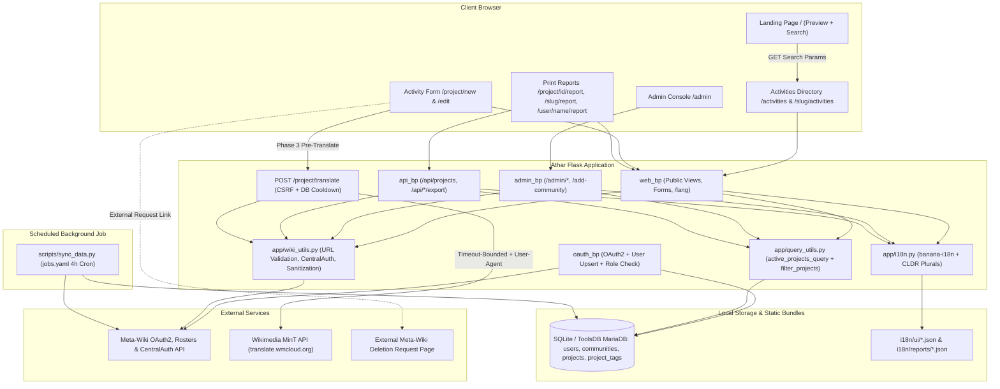

# Athar Platform Redesign, Activity Taxonomy, Multilingual Support, Theme Toggle & Admin Governance

*   **Author:** Bonnjalal00
*   **Status:** Proposed
*   **Date:** 2026-11-16

--------------------------------------------------------------------------------

## Overview

Athar is a Flask-based Wikimedia affiliate tracking platform hosted on Toolforge that collects contributor edit snapshots via scheduled jobs (`jobs.yaml` and `scripts/sync_data.py`) and lets community organizers log and export affiliate activities. This design extends Athar from an Arabic-only, community-scoped tool into a multilingual, cross-community platform delivered across three sequential phases:

1.  **Phase 1 — Core Schema, `/admin` Governance & Global Discovery:** Removes duplicate form and detail date controls and prevents `GET` requests from overwriting `"Canceled"` projects; extends `Project` with optional validated activity page links (`wiki_link`), cross-wiki `campaign` association, and separate `tags` (`project_tags` join table); adds database-backed **Tool Admins** (application-level administrators stored in the Athar database, distinct from Toolforge UNIX shell maintainers, seeded initially with `Bonnjalal00`) with an `/admin` governance console (Admin-only community creation, community editing including validated `slug` updates, cross-project Admin edits, and Admin-only soft-delete, restore, and purge); and updates `/` (`index.html`) alongside a global `/activities` directory.
2.  **Phase 2 — Translatewiki `banana-i18n` Localization & RTL/LTR Layout:** Extracts static interface strings, flash messages, CSV headers, JavaScript dictionaries, and print report templates into two Translatewiki-compatible `banana-i18n` JSON message groups (`i18n/ui/` and `i18n/reports/`, using `en` as fallback plus `ar`, with `qqq.json` message documentation), adds a header language switcher (`POST /lang`) and per-request `?lang=` report/CSV overrides, converts `codex.style.css` physical RTL offsets to CSS logical properties, and removes the broken `css/main.css` stylesheet link in `app/templates/reports/base_report.html`.
3.  **Phase 3 — Per-Activity Multilingual Content (MinT) & Dynamic Dark/Light Theme:** Adds `primary_lang` and `translations` JSON to `Project` with an expandable per-language translation panel (`"+ Add in another language"`) in `project_form.html` backed by a CSRF-protected, rate-limited Wikimedia MinT (`https://translate.wmcloud.org`) pre-translation proxy and shared `bleach.clean` HTML sanitization, plus an explicit `:root[data-theme="light|dark"]` theme switcher that keeps printable reports in light mode.

## The Problem

1.  **Siloed Activity Discovery & Broken Form/Status Controls:**
    *   Visitors arriving on `/` (`app/templates/index.html`) see only a community picker and cannot browse running activities across affiliates or search all logged activities without first clicking into a specific community.
    *   `app/templates/project_form.html` renders duplicate `start_date`, `end_date`, and `status` inputs with colliding DOM IDs and competing JavaScript handlers (`syncStatusFromDates()` vs. `updateCalculatedStatus()`), while `app/templates/project_detail.html` displays start/end dates twice.
    *   `Project.sync_status_with_dates()` in `app/models.py` passes `"auto"` to `determine_project_status()` inside `GET` handlers (`dashboard` and `community_activities`), reverting `"Canceled"` activities back to date-derived statuses and triggering database commits on read traffic.
    *   `app/static/js/filters.js` aborts if a hidden `#list-comm` element is absent, clears server-rendered cards on page load, omits `"Canceled"`, and filters only in client memory rather than sharing query logic with `app/query_utils.py`.

2.  **Missing Activity Page Links, Cross-Wiki Campaign Rollups & Portable Tags:**
    *   Organizers currently specify only `target_wiki` (e.g., `arwiki`, `commons`) rendered as a project domain link (`Project.target_wiki_url`), with no dedicated optional field (`wiki_link`) for the specific Wikimedia page, Outreach Dashboard (`wmflabs.org`), Event Metrics (`wmcloud.org`), or Toolforge (`toolforge.org`) URL of the activity.
    *   `Project` includes `project_type` (`Workshop`, `Edit-a-thon`, `Photo Walk`, `Contest`, `GLAM`, `Education Program`, `Campaign`, `Conference / Meetup`, `Hackathon`, `Translation`, `Exhibition`, `Other`), but cannot associate a contest or edit-a-thon with an umbrella cross-wiki campaign (such as *Wiki Loves Ramadan*, *Wiki Loves Monuments*, *Wiki Loves Africa*, or *1Lib1Ref*), nor attach dedicated topic `tags` that filter portably across local SQLite and Toolforge ToolsDB MariaDB.

3.  **Ungoverned Community Creation & Lack of Tool Admin Controls:**
    *   `POST /add-community` (`app/routes/web.py`) permits any logged-in Wikimedia user to insert new communities (with `index.html` stashing `pending_community_name` and `pending_community_link` across login redirects), while no UI or route exists to edit community metadata or `slug` values after creation.
    *   `oauth_callback()` (`app/oauth.py`) looks up `User` only from synced Meta-Wiki rosters without inserting missing accounts, blocking newly logged-in administrators (such as `Bonnjalal00` on a fresh database) from receiving persisted roles.
    *   In the existing authorization model (`app/oauth.py`), `User.is_member` gates activity creation (`@member_required`), while only `lead_organizer` and `co_organizers` may edit an activity (`@project_editor_required`). No Tool Admin role or soft-delete/restore/purge workflow exists when organizers need mistaken or duplicate activities removed.

4.  **Hardcoded Single-Language Arabic UI & Physical RTL Layout:**
    *   Over 60 user-facing strings across Jinja templates, Python `flash()` calls, `format_relative_time()`, CSV exporters (`app/routes/api.py`), `app/wiki_utils.py`, three standalone JavaScript files (`charts.js`, `export.js`, `filters.js`), and inline template scripts (`index.html`, `project_form.html`, `users.html`, `user_profile.html`) are hardcoded in Arabic, including concatenated sentence fragments and unpluralized counts that Translatewiki.net rejects.
    *   `app/static/css/codex.style.css` hardcodes physical RTL declarations (`direction: rtl`, `text-align: right`, `right:`/`left:` offsets), and `app/templates/base.html` suppresses `<nav class="nav-links">` on `/`, blocking English (`en`) LTR rendering and global header controls.

5.  **Mixed-Language Affiliate Reports & Incomplete Dark-Mode CSS:**
    *   Multi-language affiliates such as Wikimedia Morocco log some activities in Arabic and others in English or French; because each activity currently stores text in one language only, printable browser PDF (`@media print` HTML) and CSV exports produce mixed-language output.
    *   `app/static/css/codex.style.css` contains three partial `@media (prefers-color-scheme: dark)` blocks that collide with hardcoded inline light hex colors (`#ffffff`, `#202122`, `#54595d`) across templates and static Chart.js colors, producing inconsistent dark surfaces. Separately, `app/templates/reports/base_report.html` links a missing `static/css/main.css` file.

## Goals

### Phase 1 — Core Schema, `/admin` Governance & Global Discovery
*   **Form & Status Fixes:** Remove duplicate `start_date`/`end_date`/`status` controls in `app/templates/project_form.html` and duplicate date rows in `app/templates/project_detail.html`; eliminate database commits on `GET` requests; preserve `"Canceled"` status across web, API, and scheduled sync paths; and preserve submitted inputs on validation failures.
*   **Activity Page Links, Campaigns & Portable Tags:**
    *   Add optional `Project.wiki_link` (`String(1024)`) validated as an `https://` URL across Wikimedia project domains plus `wmcloud.org`, `wmflabs.org`, and `toolforge.org` (never auto-generated when blank).
    *   Add `Project.campaign` (`String(128)`) using a searchable input with cross-wiki campaign presets plus custom entry, separate from `project_type`.
    *   Add separate `tags` stored in a normalized `project_tags` join table with a reusable multi-chip input separate from the existing `/api/check-user` Wikimedia username lookup used for co-organizers and jury members.
*   **Database-Backed Tool Admins & `/admin` Console:**
    *   Add `User.is_admin` (seeded initially via `Config.ADMIN_USERS` defaulting to `Bonnjalal00`), insert missing OAuth `User` accounts on login (`is_member=False` for un-rostered accounts), evaluate permissions from fresh database records, guard `MOCK_AUTH` outside debug/test runs, enforce CSRF protection on mutating `api_bp` routes, and restrict `POST /add-community` to Tool Admins.
    *   Provide `/admin` for Tool Admins to grant or revoke Admin status, add and edit communities (including validated `slug` updates), edit any project, and soft-delete, restore, or purge projects (with confirmation) while excluding soft-deleted records across all non-admin queries, exports, and background syncs.
*   **Main Page (`/`) & Global `/activities` Directory:**
    *   Always render header navigation (`base.html`) on `/`, omit the Add Community form server-side for non-admins on `index.html`, display up to 6 active `In Progress` activities on `/`, and route landing searches via `GET` to `/activities` backed by unified server-side filtering across title, community, campaign, tags, type, `target_wiki`, status (including `"Canceled"`), year, and month overlap.

### Phase 2 — Translatewiki `banana-i18n` Localization & RTL/LTR Layout
*   **Translatewiki JSON Catalogs:** Externalize static UI and report strings into `i18n/ui/{en,ar,qqq}.json` and `i18n/reports/{en,ar,qqq}.json` (`en` source fallback, `$1` parameters, CLDR `{{PLURAL:$1|...}}` rules, and `qqq.json` translator documentation), replacing hardcoded Arabic strings in templates, Python routes, `format_relative_time()`, CSV exporters, and JavaScript files.
*   **Language Switching & Logical CSS:** Add a header language switcher (`POST /lang`), support per-request `?lang=` overrides on printable reports and CSV exports without changing `session['lang']`, convert physical RTL CSS rules to CSS logical properties, and remove the broken `css/main.css` link in `app/templates/reports/base_report.html`.

### Phase 3 — Per-Activity Multilingual Content (MinT) & Dynamic Dark/Light Theme
*   **Multilingual Activity Entry & MinT Proxy:** Add `primary_lang` and `translations` JSON to `Project` with an expandable per-language panel in `project_form.html`, proxy optional pre-translation calls to Wikimedia MinT via an authenticated, CSRF-protected, server-rate-limited `POST /project/translate` endpoint, sanitize all stored HTML and plain-text fields across primary and translated entries, and resolve requested languages with primary fallback in views and exports without outbound network calls on export.
*   **Dynamic Dark/Light Theme:** Replace partial dark media queries and inline hex colors with semantic CSS variables under `:root[data-theme="light"]` and `:root[data-theme="dark"]`, prevent pre-paint theme flashing with a blocking `<head>` script reading `localStorage`, add a header theme-toggle button, update `charts.js` colors dynamically, and keep printable reports in light mode.

## Non-Goals

*   In-tool organizer deletion-request forms, `deletion_requested` / `deletion_reason` database columns, or internal request review queues (organizers submit deletion requests externally on a linked Meta-Wiki page, and Tool Admins execute soft-delete, restore, and permanent purge actions in `/admin`).
*   Submitting or syncing user-created database rows (`Project` titles, descriptions, or results) to Translatewiki.net.
*   Auto-generating `wiki_link` URLs from `target_wiki` and `title` when the activity link field is left blank.
*   Running live machine translation requests during printable HTML/PDF report rendering or CSV export streaming (preserving Athar's local-only export requirement).
*   Automated scraping of Wikimedia event pages to populate `wiki_link`, `participants`, or `results`.
*   Creating SQLite database file copies on disk on deletion, or introducing external search clusters, Redis/Celery brokers, or Node.js frontend build pipelines on Toolforge.

## Open Questions

*   None (resolved: `Config.DELETION_REQUEST_URL` defaults to `""` and hides the deletion-request link on `project_detail.html` unless configured; renamed community `slug` values switch directly to `/<new-slug>/` with a warning displayed in `/admin` and no automatic redirect table).

## Critical User Journeys (CUJs)

### CUJ 1: Visitor Discovers and Filters Activities Across Communities
*   **Given:** Multiple affiliate communities have `In Progress`, `Planned`, `Completed`, and `Canceled` activities logged with campaigns (`Wiki Loves Monuments`) and tags (`heritage`, `training`).
*   **When:** A visitor opens `/` (`GET /`), views the preview of up to 6 currently running activities, enters a keyword/campaign/year filter in the landing search bar, and submits.
*   **Then:** The browser navigates to `/activities?q=...&campaign=...&year=...`, displaying server-filtered matching activities (excluding deleted records) with community badges, bookmarkable URL parameters, and interactive form refinement.

### CUJ 2: Organizer Logs an Activity with `wiki_link`, `campaign`, `tags`, and Phase 3 Translation
*   **Given:** A logged-in affiliate member opens `/project/new`.
*   **When:** They enter the activity title, optional `wiki_link` (e.g., an `outreachdashboard.wmflabs.org` or `meta.wikimedia.org` URL), select a `campaign` (`Wiki Loves Ramadan`), add `tags` chips (`ramadan`, `photography`), and—in Phase 3—add an English (`en`) translation panel, trigger `"Auto-translate with MinT"`, review the pre-filled text, and submit.
*   **Then:** The backend validates `wiki_link` against allowed Wikimedia/WMCloud/Toolforge domains, stores normalized tags, sanitizes HTML and plain-text fields across primary and translated entries, saves the activity, and preserves `"Canceled"` status across subsequent views.

### CUJ 3: Tool Admin (`Bonnjalal00`) Governs Communities, Projects, and Soft Deletes via `/admin`
*   **Given:** `Bonnjalal00` is signed in via Wikimedia OAuth (or another Tool Admin promoted in `/admin`).
*   **When:** The Admin opens `/admin` to add a new community, edits an existing community's name, roster URL, contact email, or `slug`, edits a user's project, or soft-deletes a mistaken test project (and optionally restores or permanently purges it after ID confirmation).
*   **Then:** Non-admin users receive HTTP 403 on `POST /add-community` and `/admin`, soft-deleted projects vanish from `/`, `/activities`, dashboards, KPIs, CSV/printable reports, and sync jobs while remaining recoverable in `/admin` until purged, and organizers see a link to the Meta-Wiki request page when `DELETION_REQUEST_URL` is configured.

### CUJ 4: Multilingual User Switches UI Language and Exports a Report in Another Language
*   **Given:** An Arabic-speaking coordinator is browsing Athar in Arabic (`ar`, `dir="rtl"`) while a grant officer needs an English report (`en`, `dir="ltr"`).
*   **When:** The user submits the header language switcher on any page (including `/`) to switch UI language, or selects English (`?lang=en`) when exporting a printable report (`/project/<id>/report`, `/<slug>/report`, `/user/<username>/report`) or CSV from `/export`.
*   **Then:** Interface labels, navigation, relative timestamps, and client charts update via `banana-i18n` bundles with logical directional layout, and the exported printable report or CSV renders headers, statuses, and activity translations in English (falling back to primary activity text where missing) without changing the coordinator's active UI session language.

### CUJ 5: User Toggles Dark/Light Mode While Printing Light-Mode Reports
*   **Given:** A user opens Athar with Dark Mode selected via the header theme button (persisted in `localStorage`).
*   **When:** They navigate across `/`, `/activities`, `/<slug>/`, and `/project/<id>`, and then click `"Print PDF Report"`.
*   **Then:** Web pages render in `:root[data-theme="dark"]` without a pre-paint light flash (including themed Chart.js canvases), while `/project/<id>/report` and `/<slug>/report` load in forced light mode with HTTP 200 across all page resources.

--------------------------------------------------------------------------------

## Technical Plan (Architecture)

### 1. High-Level System Architecture & Data Flow

Athar separates synchronous local database reads (web pages, global search, and printable HTML/CSV exports) from authenticated authoring workflows and scheduled background ingestion. Only form-authoring helpers (Wikimedia CentralAuth username verification, single-page roster parsing on community setup, and Phase 3 MinT translation assistance) make bounded outbound requests on explicit user action, keeping all directory, dashboard, and export rendering decoupled from external network calls.

### 2. Phase 1 — Database Schema Extensions, Migration & Data Contracts

#### Model Additions (`app/models.py`)
*   **`User` model extensions:**
    *   `is_admin = db.Column(db.Boolean, default=False, nullable=False)` granting Tool Admin governance capabilities independent of community roster membership (`is_member`).
    *   Phase 3 server-side rate-limit state columns: `mint_window_start = db.Column(db.DateTime, nullable=True)` and `mint_window_count = db.Column(db.Integer, default=0, nullable=False)` so rate limiting works across Gunicorn workers without Redis or bypassable cookie counters.
*   **`Community` model cascade update:**
    *   Update `Community.projects` relationship cascade from `"all, delete-orphan"` to `"save-update, merge"` so accidental community changes never hard-delete child projects (and forbid community deletion in `/admin`).
*   **`Project` model extensions:**
    *   `wiki_link = db.Column(db.String(1024), nullable=True)` (unindexed `VARCHAR(1024)` so percent-encoded Arabic/non-ASCII URLs fit without exceeding MariaDB InnoDB's 3072-byte `utf8mb4` index key limit).
    *   `campaign = db.Column(db.String(128), nullable=True, index=True)` for umbrella cross-wiki campaign association, separate from `project_type`.
    *   `primary_lang = db.Column(db.String(16), default="ar", nullable=False)` recording the source language of `title`, `description`, `results["summary"]`, and `results["notes"]`.
    *   `translations = db.Column(MutableDict.as_mutable(db.JSON), nullable=True)` (Phase 3 per-language dictionary storing reviewed overrides, `NULL` in DDL, tracked via `sqlalchemy.ext.mutable.MutableDict`).
    *   `is_deleted = db.Column(db.Boolean, default=False, nullable=False, index=True)`, `deleted_at = db.Column(db.DateTime, nullable=True)`, and `deleted_by = db.Column(db.String(128), nullable=True)` for Admin-managed soft deletion.
    *   Composite index `ix_projects_active_status_start` on `(is_deleted, status, start_date)` for landing-page `In Progress` lookups.
    *   Relationship: `tags_rel = db.relationship("ProjectTag", back_populates="project", lazy=True, cascade="all, delete-orphan")` plus convenience property `tags` returning sorted normalized tag strings.
*   **`ProjectTag` model (`__tablename__ = "project_tags"`):**
    *   Composite primary key `(project_id, tag)` where `project_id` is `db.ForeignKey("projects.id", ondelete="CASCADE")` and `tag` is `db.String(64)` with an index on `tag`. Using a normalized join table ensures identical, indexed SQL filtering across both SQLite and MariaDB.

#### Idempotent Schema Migration (`scripts/migrate_v3.py`)
`scripts/migrate_v3.py` resolves the database URI directly via `config.resolve_database_uri()` (without calling `create_app()`, avoiding startup guards or model query hooks before DDL runs) and inspects schema metadata on SQLite and MariaDB (`mysql+pymysql`):
1.  Adds `users.is_admin BOOLEAN NOT NULL DEFAULT 0`, `users.mint_window_start DATETIME NULL`, and `users.mint_window_count INT NOT NULL DEFAULT 0` if missing.
2.  Adds `projects.wiki_link VARCHAR(1024) NULL`, `projects.campaign VARCHAR(128) NULL`, `projects.primary_lang VARCHAR(16) NOT NULL DEFAULT 'ar'`, `projects.translations JSON NULL`, `projects.is_deleted BOOLEAN NOT NULL DEFAULT 0`, `projects.deleted_at DATETIME NULL`, and `projects.deleted_by VARCHAR(128) NULL` if missing.
3.  Creates `project_tags` using `ProjectTag.__table__.create(bind=conn, checkfirst=True)` (ensuring matching InnoDB/utf8mb4 FK types on MariaDB) and refreshes `inspector = inspect(engine)` before creating missing indexes (`ix_projects_campaign`, `ix_projects_is_deleted`, `ix_projects_active_status_start`, `ix_project_tags_tag`).
4.  Audits existing `users.username` values for whitespace/underscore normalization collisions (`normalize_username()`), and idempotently seeds `"Bonnjalal00"` plus every username in `Config.ADMIN_USERS` as `is_admin = 1` (inserting missing rows explicitly with `is_member = 0`, appending to `actions` only when a row is actually inserted or updated so repeated runs return `[]`).
5.  Documents that MariaDB DDL (`ALTER TABLE`, `CREATE TABLE`, `CREATE INDEX`) executes implicit commits per statement; safety relies on per-item existence checks rather than multi-DDL rollback.

#### `wiki_link` Validation, Sanitization & Status Cleanup (`app/wiki_utils.py`, `app/templates/project_form.html`, `app/templates/project_detail.html`)
*   **`validate_activity_wiki_url(raw_url)` in `app/wiki_utils.py`:**
    *   Returns `None` for empty or whitespace-only inputs (never auto-generating links from `target_wiki` + `title`).
    *   Reuses `is_allowed_wikimedia_host(hostname, allowed_domains=ALLOWED_ACTIVITY_LINK_DOMAINS)` where `ALLOWED_ACTIVITY_LINK_DOMAINS = ALLOWED_WIKIMEDIA_DOMAINS + ("wmcloud.org", "wmflabs.org", "toolforge.org")`.
    *   Normalizes explicit `http://` prefixes—and scheme-less inputs whose leading segment contains `.` and no `:`—to `https://`, then parses via `urllib.parse.urlparse()`.
    *   Raises `ValueError` on any invalid condition: non-`https` scheme (`javascript:`, `data:`, `ftp:`), embedded `username` or `password` (`evil.com@ar.wikipedia.org`), explicit `port` (catching `ValueError` from malformed ports), backslashes (`\`), whitespace or control characters, missing `hostname`, length `> 1024`, or `hostname` failing `is_allowed_wikimedia_host(..., ALLOWED_ACTIVITY_LINK_DOMAINS)`. Empty `path == ""` (e.g., `https://eventmetrics.wmcloud.org`) is permitted.
*   **`sanitize_project_text_fields(...)` in `app/wiki_utils.py`:**
    *   Used by both `web_bp` and `api_bp` (for `title`, `description`, `results` summary/notes/winners, and Phase 3 `translations`).
    *   Plain-text fields (`title`, `results_summary`, `results_notes`) strip all HTML (`bleach.clean(val, tags=[], attributes={}, strip=True).strip()`), rejecting an empty post-sanitization `title` with HTTP 400.
    *   `description` uses `bleach.clean(val, tags=["p", "b", "i", "strong", "em", "ul", "ol", "li", "a", "br"], attributes={"a": ["href", "title"]}, protocols=["http", "https"], strip=True)` paired with a linkify/bleach callback enforcing `rel="noopener noreferrer"` on `<a>` tags.
*   **Form & Status Fixes (`project_form.html`, `project_detail.html`, `web.py`, `api.py`, `wiki_utils.py`):**
    *   Remove the duplicate `start_date`, `end_date`, and `status` block in `app/templates/project_form.html` (`lines 133-168` and `554-626`) and duplicate date rows in `app/templates/project_detail.html` (`lines 79-91`), leaving one unambiguous date/status control group with `"Canceled"` selectable.
    *   Extract a shared project-payload parser/validator in `app/wiki_utils.py` used by both `web.py` (`create_project`, `edit_project`) and `api.py` (`create_projetct` `[sic]`, `update_project`, keeping `api.py`'s optional dates and manual status overrides while preserving `web.py`'s date-derived calculation for non-`Canceled` forms so existing `tests/test_routes.py` assertions hold).
    *   Update `determine_project_status(start_date, end_date, requested_status, current_status=None)` to normalize `"Canceled"` / `"Cancelled"` / `"ملغي"` to `"Canceled"`, and preserve `"Canceled"` when `current_status` is `"Canceled"` and `requested_status` is `"auto"`. Update `Project.sync_status_with_dates()` and `api.py:update_project()` accordingly.
    *   Remove `sync_status_with_dates()` + `db.session.commit()` from `GET` handlers (`dashboard`, `community_activities`), moving periodic status transitions into `scripts/sync_data.py:sync_active_project_statuses()` invoked inside `run_sync()`.
    *   Pass a `form_data` dictionary back to `project_form.html` on HTTP 400 errors in `create_project` and `edit_project` so entered `title`, `wiki_link`, `campaign`, `tags`, dates, descriptions, and `translations_json` are retained.

#### Separate `campaign` and `tags` Contracts
*   **`campaign`:** Searchable `<input list="campaigns-list">` pre-populated with cross-wiki `PRESET_CAMPAIGNS` (*Wiki Loves Ramadan*, *Wiki Loves Monuments*, *Wiki Loves Africa*, *Wiki Loves Earth*, *Wiki Loves Folklore*, *1Lib1Ref*, *Feminism and Folklore*, *WikiGap*, *SheSaid*, *CEE Spring*, *WikiForHumanRights*) plus custom entry (`<= 128` chars, trimmed), independent of `project_type`.
*   **`tags`:** Modular `app/static/js/chip-input.js` widget operating in two modes (`mode: "wikimedia_user"` retaining `/api/check-user` verification for co-organizers/jury, vs. `mode: "tag"` performing synchronous normalization without network calls). In `tag` mode, entering `,` or `Enter` strips leading `#`, lowercases/collapses whitespace, deduplicates, and caps at 20 tags (`<= 64` chars each). Pending text in `tag` mode auto-commits synchronously on blur/submit; in `wikimedia_user` mode, submit waits for any in-flight `/api/check-user` promise before posting. On `PUT /api/projects/<id>`, omitted `"tags"` leaves existing tags unchanged while explicit `"tags": []` clears them, and `> 20` tags returns HTTP 400.

### 3. Phase 1 — Authentication, Tool Admin Governance (`/admin`) & Soft-Delete Scope

#### OAuth & Role Resolution (`app/oauth.py`, `config.py`, `app/__init__.py`)
*   Add `Config.ADMIN_USERS` (parsed from comma-separated `ADMIN_USERS` env var into a `set[str]`, defaulting to `{"Bonnjalal00"}`), `Config.DELETION_REQUEST_URL` (default `""`; when empty, the deletion-request link on `project_detail.html` is omitted), `Config.DEBUG` (boolean parsed from `DEBUG` or `FLASK_DEBUG`), `Config.MOCK_USERNAME` (`"MoroccoVolunteer"` default), and `Config.MOCK_IS_ADMIN` (`False` default).
*   Add startup guard in `create_app()`: raise `RuntimeError` if `MOCK_AUTH=True` while `not Config.TESTING` and (`not Config.DEBUG` or real non-placeholder `OAUTH_CLIENT_ID` is configured). Update `.env.example` so `OAUTH_CLIENT_ID` is empty when `MOCK_AUTH=True`.
*   Normalize `get_current_user()` so `MOCK_AUTH=True` upserts/loads a real `User` row matching `MOCK_USERNAME` (with `is_member=True`, `is_admin=MOCK_IS_ADMIN`) and non-mock sessions query `User` via `normalize_username()` and `func.lower(User.username)`.
*   Update `oauth_callback()` to look up `User` case-insensitively: if missing, insert `User(username=canonical, is_member=False, is_admin=(norm_lower in seeded_admins))`; if already present, keep its database `is_admin` value untouched (never re-promoting an admin who was revoked in `/admin`).
*   Evaluate `is_admin` and `is_member` directly from the database `User` record on each request:
    *   `@admin_required`: requires `current_user` and `current_user.is_admin`.
    *   `@member_required`: requires `current_user` and (`current_user.is_member or current_user.is_admin`) so un-rostered Tool Admins are not locked out of activity creation, MinT translation, or community sync.
    *   `@project_editor_required`: uses `get_active_project_or_404()`, requires `current_user` and (`current_user.is_admin` or case-insensitive normalized match against `lead_organizer` or `co_organizers`).
    *   Decorate `POST /<slug>/sync` with `@member_required`.

#### RBAC Access Matrix

| Role / State | View Public & Export | Create Project / MinT / Sync | Edit Project | `/admin`, Community Add/Edit, Soft-Delete/Restore/Purge |
| :--- | :--- | :--- | :--- | :--- |
| **Anonymous** | Active only (404 on deleted) | Redirect 302 (JSON 401 on `/project/translate`) | Redirect 302 | Redirect 302 |
| **Non-Member Logged-In** (`is_member=False, is_admin=False`) | Active only | HTTP 403 | HTTP 403 | HTTP 403 |
| **Community Member** (`is_member=True`) | Active only | Allowed | HTTP 403 unless organizer | HTTP 403 |
| **Project Organizer** (Lead or Co-Organizer) | Active only | Allowed | Allowed (Active only) | HTTP 403 |
| **Tool Admin** (`is_admin=True`) | Active publicly; Deleted in `/admin` | Allowed (`@member_required` pass-through) | Allowed (Active only) | Allowed |

#### Admin Console & Governance Endpoints (`app/routes/admin.py`, Blueprint `admin_bp`)
All routes in `admin_bp` enforce `@admin_required` and Flask-WTF CSRF tokens:

| Route | Behavior & Validation |
| :--- | :--- |
| `GET /admin` | Renders `app/templates/admin.html` with communities list, active moderation table (title, community, status, Edit + Soft-Delete actions), soft-deleted projects (`Project.query.filter(Project.is_deleted.is_(True))`) with Restore + Purge actions, and current Tool Admins. |
| `POST /add-community` | Moved from `web_bp` to `admin_bp` (non-admin UI form, empty-search CTA, and `pending_community_*` session stash removed from `index.html` and `web.py`). Validates unique `name <= 120`, ASCII `[a-z0-9-]` non-empty `slug <= 64` (uniqueness + `RESERVED_SLUGS`), and Wikimedia `meta_roster_page <= 255` normalized via `normalize_meta_page_title()`; creates `Community` and runs single-page Meta-Wiki roster parse synchronously (`timeout=15`) without Gunicorn daemon threads (leaving bulk CentralAuth metrics to `jobs.yaml`). |
| `POST /admin/community/<int:id>/edit` | Validates `name` uniqueness (`<= 120`), non-empty ASCII `[a-z0-9-]` `slug` (`<= 64`, unique, not in `RESERVED_SLUGS`), and `meta_roster_page` (`<= 255`); updates `session['community_slug']` if it matched the old slug; runs `parse_members` synchronously (`timeout=15`) if roster URL changed. Relational FKs (`communities.id`) stay intact. |
| `POST /admin/project/<int:id>/soft-delete` | Sets `is_deleted=True`, `deleted_at=utcnow()`, `deleted_by=current_user.username`; logs `current_app.logger.info` audit JSON (`actor`, `action`, `target_type`, `target_id`, `details`). |
| `POST /admin/project/<int:id>/restore` | Sets `is_deleted=False`, clears `deleted_at`/`deleted_by`, logs audit event. |
| `POST /admin/project/<int:id>/purge` | Requires `project.is_deleted == True` AND form field `confirm_project_id == str(project.id)` before deleting record and logging audit event. |
| `POST /admin/admins/grant` | Calls shared `verify_wikimedia_username(username)` helper (local DB + CentralAuth via `Config.USER_AGENT`); inserts `User(is_member=False)` if absent; sets `is_admin=True`; logs audit event. |
| `POST /admin/admins/revoke` | Blocks self-revocation (`target.id == current_user.id`) and blocks removing the last remaining `is_admin=True` user; sets `is_admin=False`; logs audit event. |

#### Single Soft-Delete Query Boundary & CSRF Hardening
*   Commit to **one** explicit mechanism: `active_projects_query()` (`Project.query.filter(Project.is_deleted.is_(False))`) and `get_active_project_or_404(project_id)` in `app/query_utils.py`, applied consistently across all 19 non-admin query touchpoints:
    *   `web.py`: `index`, `global_activities`, `dashboard`, `community_activities`, `community_users`, `view_project`, `edit_project`, `user_profile`, `project_report`, `community_report`, `user_report`, `export_view` (`SELECT DISTINCT` year query).
    *   `api.py`: `get_stats`, `list_projects`, `slug_Stat` (including raw `db.session.query` counts/groupings and fixing duplicate queries at `lines 159-202`), `list_slug_project`, `get_project`, `update_project`, `export_project_csv`, `export_user_projects_csv`, `exp_community_projects`.
    *   `oauth.py`: `@project_editor_required`.
    *   `scripts/sync_data.py`: `sync_project_contributors` and `sync_active_project_statuses`.
*   Enforce CSRF token verification on session-cookie-authenticated mutating `POST`/`PUT` routes in `api_bp` (`POST /api/<slug>/projects`, `PUT /api/projects/<id>`) by calling `csrf.protect()` inside those mutating handlers (keeping read-only `GET` API routes exempt and passing `<meta name="csrf-token">` from `base.html` for browser JS).
*   Extract `get_latest_snapshots_total(user_ids)` in `app/query_utils.py` (reusing `community_report()`'s subquery pattern) to eliminate N+1 snapshot loops in `dashboard()`, `community_users()`, `slug_Stat()`, and `list_members()`.

### 4. Phase 1 — Main Page (`/`), Global `/activities` & Unified Filtering

#### Route Reservation & Global Header (`app/routes/web.py`, `app/__init__.py`, `app/templates/base.html`)
*   Expand `RESERVED_SLUGS` to `{"user", "project", "export", "api", "auth", "static", "admin", "activities", "login", "logout", "oauth", "add-community", "lang"}`.
*   Register `@app.context_processor` in `app/__init__.py` injecting `current_user`, `current_locale`, and `locale_dir` across all views and error templates.
*   Remove the `request.endpoint != 'web.index'` check in `app/templates/base.html` so navigation links (`/activities`, `/export`, `/admin` when `current_user.is_admin`, and login/logout) display on `/` as well as subpages. Remove the duplicate Chart.js `<script>` in `base.html` (`dashboard.html:116` already loads Chart.js).

#### Landing Page (`GET /`, `app/templates/index.html`)
*   Query up to 6 active `In Progress` projects across all communities (`active_projects_query().filter(Project.status == "In Progress").options(joinedload(Project.community), selectinload(Project.tags_rel), defer(Project.translations)).order_by(Project.start_date.desc(), Project.created_at.desc()).limit(6)`), plus distinct campaigns/years for filter dropdowns.
*   Render three distinct blocks:
    1.  **Global Activity Search Bar:** `<form method="GET" action="/activities">` with `q`, `campaign` datalist, `tag`, `status` (`In Progress`, `Planned`, `Completed`, `Canceled`), `year`, and `month` inputs.
    2.  **Running Activities Preview:** Up to 6 activity cards displaying community badge, type, status, dates, campaign/tags, and a `"View All Activities"` link to `/activities`.
    3.  **Community Selector:** Searchable affiliate list (showing `"Add Community"` link to `/admin` only when `current_user.is_admin`).

#### Unified Server-Side Filtering & Global `/activities` (`app/query_utils.py`, `app/routes/api.py`, `app/templates/activities.html`, `app/static/js/filters.js`)
*   Delete redundant `_filter_projects_by_date` in `app/routes/api.py` and unify `GET /activities`, `GET /<slug>/activities`, `GET /api/projects`, `GET /api/<slug>/projects`, and `GET /api/<slug>/export` onto `filter_projects(query, args)`:
    *   `eff_start = func.coalesce(Project.start_date, func.date(Project.created_at))` and `eff_end = func.coalesce(Project.end_date, Project.start_date, func.date(Project.created_at))`.
    *   Date range / year / month overlap: `eff_start <= period_end` and `eff_end >= period_start` (returning empty results for `year=1999` on projects whose `created_at` is in another year, preserving `tests/test_api.py`). When `month` is provided without `year`, match `extract('month', eff_start) == m` OR `extract('month', eff_end) == m` (or start <= month <= end within the same year).
    *   `q`: Case-insensitive `ILIKE`/`LIKE` across `Project.title`, `Project.campaign`, and `Project.description`.
    *   `community`: Exact `Community.slug` join filter (empty list if unknown slug on `/activities`).
    *   `campaign`: Case-insensitive substring match on `Project.campaign`.
    *   `tag` / `tags`: Comma-separated normalized tags requiring **all** specified tags (`AND` matching via `Project.tags_rel.any(ProjectTag.tag == t)` per tag).
    *   `target_wiki`: Normalized alias/domain match preserving `tests/test_api.py:147-151`.
    *   `type` / `project_type`: Standard match plus `"Other"` exclusion of standard type keys (`Workshop`, `Edit-a-thon`, etc.).
    *   `status`: Exact normalized match supporting `"Canceled"` / `"Cancelled"` equivalence plus existing `filter_projects_by_status()` inclusion flags.
*   Keep `GET /api/projects` returning a flat JSON array with `joinedload(Project.community)`, `selectinload(Project.tags_rel)`, and `defer(Project.translations)`.
*   Simplify `GET /activities` and `GET /<slug>/activities` to render server-filtered Jinja cards (bounded to `LIMIT 100` or `?page=` pagination on HTML) linking directly to `/project/<id>`, retiring the redundant JS card/modal DOM builder in `app/static/js/filters.js` (keeping `filters.js` minimal for form reset/submission UX or deleting unused modal code). This guarantees bookmarkable URLs, eliminates SSR/CSR template drift, and resolves HTML-description modal rendering issues.

### 5. Phase 2 — Translatewiki `banana-i18n` Architecture & RTL/LTR CSS Logical Properties

#### `banana-i18n` Message Groups & Engine (`app/i18n.py`, `i18n/ui/`, `i18n/reports/`)
*   Maintain two Translatewiki-compatible message groups (`i18n/ui/{en,ar,qqq}.json` and `i18n/reports/{en,ar,qqq}.json`) with `"@metadata"`, English fallback, `$1`/`$2` parameters, and CLDR `{{PLURAL:$1|...}}` syntax.
*   `Config.DEFAULT_LOCALE = "ar"`; `SUPPORTED_LOCALES` is discovered at startup from `i18n/ui/*.json` excluding `"qqq"`. Requested `?lang=` and cookie values are checked strictly against `SUPPORTED_LOCALES` to prevent path traversal.
*   Expose `_ (key, *args)` (`ui` domain) and `_r(key, *args)` (`reports` domain falling back to `ui` for shared activity types, statuses, roles, and dates) to Jinja and Python routes, along with `t_type(val, lang=None)` and `t_status(val, lang=None)` (updating `ar_type`/`ar_status` to accept optional `lang` defaulting to `g.report_lang` or `current_locale()`, and replacing parameterless `{{ p.status_ar }}` in `reports/*.html` so `?lang=en` works across all labels).
*   Add `POST /lang` (CSRF-protected, validating relative `next` URL via `urlparse` before redirect) updating `session['lang']`. Report and CSV routes read `?lang=` into `g.report_lang` for that request without mutating `session['lang']`.
*   Resolve CLDR plural forms across standard Translatewiki locales via a lightweight plural-rule selector table (supporting Arabic 6-form, English 2-form, French, etc.), and expose `window.ATHAR_I18N` with a shared client `atharI18n.t(key, ...args)` helper using `Intl.PluralRules` for dynamic JS counts (`index.html`, `users.html`, `export.js`).

#### CSS Logical Properties & Report Stylesheet Fix
*   Migrate physical directional rules in `app/static/css/codex.style.css` (`direction: rtl`, `text-align: right`, `right:`, `left:`, `margin-left`, `padding-right`, `padding: 10px 40px 10px 36px` on `.community-search-input`, `translateX(-4px)`), `app/static/js/export.js` (`lines 245-261`), `index.html:52`, and `dashboard.html:61` to CSS logical properties (`text-align: start`, `inset-inline-start`, `padding-inline-start`, `padding-inline-end`) and `[dir="ltr"]` / `[dir="rtl"]` directional arrow icons.
*   Remove `<link href=".../css/main.css">` from `app/templates/reports/base_report.html` (`404` on every report), bind `<html lang="{{ report_lang }}" dir="{{ report_dir }}">`, convert `text-align: right/left` to `start/end`, and add `?lang=` quick toggle links in `.no-print`.

### 6. Phase 3 — Per-Activity Multilingual Content (`translations` + MinT) & Dynamic Dark/Light Theme

#### Activity `translations` & Wikimedia MinT Proxy (`app/models.py`, `app/routes/web.py`, `translation-panel.js`)
*   **Storage Schema & Size Caps:** `Project.translations` stores non-primary language entries keyed by validated BCP-47/Wikimedia language code (`^[a-z]{2,12}(-[a-z0-9]{2,12})*$`, max 20 languages per project):
    `{"en": {"title": str <= 255, "description": str <= 10240, "results_summary": str <= 4096, "results_notes": str <= 4096}}`.
    Top-level fields (`Project.title`, `Project.description`, `Project.results["summary"]`, `Project.results["notes"]`) always hold `Project.primary_lang` (no duplicate `translations[primary_lang]` shadow copy; changing `primary_lang` removes any redundant matching key or swaps cleanly).
*   **Model Helpers & Serialization:**
    *   `Project.localized_text(field_name, target_lang) -> str` (maps `"results_summary"` -> `results["summary"]`, `"results_notes"` -> `results["notes"]`, returning non-empty `translations[target_lang][field_name]` or primary fallback).
    *   `Project.localized_source_lang(field_name, target_lang) -> str` (returns `target_lang` when translated text is present, otherwise `self.primary_lang` for `<bdi dir="auto">` wrapping in views/reports).
    *   `Project.to_dict(lang=None)` returns `localized_title`, `localized_description`, and `localized_lang` alongside `translations` when `lang` is supplied without breaking top-level `title`/`description` compatibility.
*   **Wikimedia MinT Proxy Contract (`POST /project/translate`):**
    *   Protected by Flask-WTF CSRF (`<meta name="csrf-token">` in `base.html`) and `@member_required` (which permits `is_admin` and returns JSON `401` when unauthenticated or `403` when unauthorized for AJAX `X-Requested-With` / `application/json` calls instead of a 302 HTML redirect).
    *   Enforces a DB-backed per-user cooldown on `User` (`mint_window_start`, `mint_window_count`: max `10` requests per 60-second window across all Gunicorn workers, returning HTTP `429` JSON `{"error": ...}` when exceeded).
    *   Coalesces all four fields into one client request:
        *   **Request JSON:** `{"source_lang": "ar", "target_lang": "en", "fields": {"title": "...", "description": "...", "results_summary": "...", "results_notes": "..."}}` (total UTF-8 byte cap `<= 12 KB`).
        *   **Upstream Call:** Caches `GET {MINT_API_URL}/languages` in memory (6h TTL). Translates non-empty fields against `POST {MINT_API_URL}/translate/{source_lang}/{target_lang}` (`timeout=10`, `Config.USER_AGENT`), sending `format="html"` for `description` and `format="text"` for plain-text fields. Passes all translated responses through `sanitize_project_text_fields()` before returning JSON.
        *   **Response JSON (`200`):** `{"target_lang": "en", "fields": {"title": "...", "description": "...", "results_summary": "...", "results_notes": "..."}}`; returns HTTP `400` (unsupported pair), `502`/`504` (upstream error/timeout) so `translation-panel.js` falls back gracefully to manual editing.

#### Dynamic Dark/Light Theme System (`app/static/css/codex.style.css`, `base.html`, `theme.js`, `charts.js`)
*   Consolidate the three partial `@media (prefers-color-scheme: dark)` blocks and remove hardcoded inline hex colors across templates and `export.js` (`lines 245-261`) in favor of semantic CSS variables scoped to `:root, :root[data-theme="light"]` and `:root[data-theme="dark"]`.
*   Place a blocking inline `<script>` inside `<head>` of `app/templates/base.html` before stylesheets with `try { ... } catch (e) {}` reading `localStorage.getItem("athar-theme")` (falling back to `window.matchMedia("(prefers-color-scheme: dark)").matches ? "dark" : "light"`) and setting `document.documentElement.dataset.theme` prior to first paint.
*   Add `app/static/js/theme.js` to handle header toggle clicks and dispatch `athar:themechange`. Update `app/static/js/charts.js` to read CSS variables on **initial** render as well as on `athar:themechange`. Keep `app/templates/reports/base_report.html` pinned to light mode.

--------------------------------------------------------------------------------

## Alternatives Considered

### Alternative A: Two Translatewiki.net Subprojects (Static UI vs. Database Activities)
*   **Pros**:
    *   Reuses volunteer translation workflows on Translatewiki.net for both tool labels and activity descriptions.
*   **Cons**:
    *   Translatewiki.net reads only static message files committed to a public Git repository; it cannot sync live rows in Athar's SQLite or MariaDB database or keep up with newly created organizer events.
*   **Reason for Rejection**: Translatewiki is scoped strictly to static UI and report templates (`i18n/ui/` and `i18n/reports/`), while per-activity multilingual titles and descriptions are stored in `Project.translations` (Phase 3) where organizers can pre-translate with MinT and save immediately.

### Alternative B: In-Tool Organizer Deletion-Request Ticket Queue (`deletion_requested` & `deletion_reason` Columns)
*   **Pros**:
    *   Keeps every organizer deletion request and Admin moderation response inside one database and web UI.
*   **Cons**:
    *   Adds extra schema columns, withdrawal/rejection state transitions, notification banners, and moderation queue endpoints for a low-frequency administrative task.
*   **Reason for Rejection**: Linking from `project_detail.html` to a Meta-Wiki request page while reserving soft-delete, restore, and permanent purge for Tool Admins in `/admin` eliminates unnecessary database state.

### Alternative C: Single-Release Monolithic Rollout vs. Three-Phase Staged Delivery
*   **Pros**:
    *   Delivers global discovery, `/admin`, `banana-i18n`, MinT translations, and dark mode simultaneously.
*   **Cons**:
    *   Shipping schema changes, RBAC, global filtering, full localization, MinT, and CSS theming in one deployment creates high schema and regression risk in a ~1,800-line codebase lacking Alembic.
*   **Reason for Rejection**: Splitting delivery into three sequential phases isolates schema migrations, Admin governance, and global filtering in Phase 1 before introducing Translatewiki `banana-i18n` + logical CSS in Phase 2 and `Project.translations`/MinT + theme switching in Phase 3.

### Alternative D: Raw `db.JSON` Array Column for `Project.tags` vs. Normalized `project_tags` Join Table
*   **Pros**:
    *   Requires only one new column without creating a join table.
*   **Cons**:
    *   SQLite (`json_each`) and Toolforge ToolsDB MariaDB (`JSON_CONTAINS`) do not share a portable indexed SQL operator for JSON array membership.
*   **Reason for Rejection**: Modeling separate tags in an indexed `project_tags` join table (`project_id`, `tag`) provides portable, indexed SQL filtering across both SQLite and MariaDB.

### Alternative E: Auto-Generating `wiki_link` from `target_wiki` and `Project.title` When Blank
*   **Pros**:
    *   Produces a clickable link for every activity even when the organizer leaves the link field empty.
*   **Cons**:
    *   Human-readable event titles rarely match exact MediaWiki page titles or namespaces, producing HTTP 404 redlinks, and interwiki syntax like `commons:Title` is invalid in `<a href>`.
*   **Reason for Rejection**: Keeping `wiki_link` optional and storing either a validated `https://` Wikimedia/WMCloud/Toolforge URL or `NULL` prevents broken links across views and reports.

### Alternative F: Merging Campaigns and Tags into a Single Free-Text Field
*   **Pros**:
    *   Reduces the number of classification inputs on `project_form.html`.
*   **Cons**:
    *   Recurring cross-wiki programs (*Wiki Loves Monuments*, *Wiki Loves Ramadan*, *1Lib1Ref*) fracture across inconsistent spellings and mix with ad-hoc topic keywords.
*   **Reason for Rejection**: Keeping `campaign` (searchable cross-wiki presets plus custom entry) separate from `tags` (`project_tags` multi-chip keywords) keeps program reporting structured while preserving topic filtering.

### Alternative G: Immutable `Community.slug` After Creation vs. Admin-Editable `slug`
*   **Pros**:
    *   Prevents breaking existing bookmarked `/<slug>/` URLs once a community is created.
*   **Cons**:
    *   Forces Tool Admins to run manual SQL updates on ToolsDB whenever a community slug contains a typo or needs renaming.
*   **Reason for Rejection**: Because `Project.community_id` and `CommunityMember.community_id` reference the integer primary key `communities.id`, allowing Tool Admins to edit `slug` in `/admin` (with ASCII `[a-z0-9-]`, uniqueness, and `RESERVED_SLUGS` checks plus a bookmark warning) enables safe fixes without breaking relational data.

### Alternative H: On-the-Fly Machine Translation During Report Rendering or CSV Export
*   **Pros**:
    *   Avoids adding `primary_lang` or `translations` fields to `Project`.
*   **Cons**:
    *   Making synchronous HTTP calls to `translate.wmcloud.org` for dozens of rows during report/CSV export violates Athar's local-only export rule, risks Toolforge HTTP 504 timeouts across 4 Gunicorn workers, and inserts unreviewed machine-translation errors into official reports.
*   **Reason for Rejection**: Pre-translating via MinT inside `project_form.html` (Phase 3) lets organizers or Admins review and edit text before saving, keeping all report and CSV routes local and under `<500ms` at typical affiliate dataset scales (<500 projects).

### Alternative I: Copying SQLite Database Files on Disk Prior to Project Deletion
*   **Pros**:
    *   Preserves raw snapshots without adding soft-delete columns to `Project`.
*   **Cons**:
    *   Production runs on Toolforge ToolsDB MariaDB (`mysql+pymysql`), not SQLite files, and file copies risk write-lock conflicts and disk bloat.
*   **Reason for Rejection**: Soft-delete columns (`is_deleted`, `deleted_at`, `deleted_by`) managed via `/admin` work identically across SQLite and MariaDB, support single-activity restoration, and enforce ID-confirmed permanent purging.

--------------------------------------------------------------------------------

## Non-Functional Requirements

### Security & Privacy
*   **Cross-Site Scripting (XSS) Sanitization:** All primary fields and `Project.translations[lang]` entries pass `sanitize_project_text_fields()` across `web_bp` and `api_bp` (`bleach.clean` HTML whitelist + `rel="noopener noreferrer"` on `description`; full tag stripping on plain-text fields).
*   **Strict URL & Locale Validation:** `wiki_link` enforces `https://` without userinfo/ports/backslashes against `ALLOWED_ACTIVITY_LINK_DOMAINS`, and locale codes validate against discovered `i18n/ui/*.json` files (excluding `qqq`).
*   **CSRF, RBAC & Auth Hardening:** All `/admin` routes, `POST /lang`, `POST /project/translate`, and mutating `POST`/`PUT` routes on `api_bp` enforce Flask-WTF CSRF validation. Permissions (`is_admin`, `is_member`) are evaluated from live DB state, `POST /<slug>/sync` requires `@member_required`, `User` auto-inserts on `oauth_callback()` default to `is_member=False`, self/last-admin revocation is blocked, and `create_app()` blocks `MOCK_AUTH=True` outside debug/testing setups.
*   **CSV Formula Injection Mitigation:** All CSV exports continue applying `sanitize_csv_cell()` across localized and primary values.

### Performance & Latency
*   **Local-Only Page & Export Execution:** Directory views, dashboards, contributor profiles, printable reports, and streaming CSV exports make zero outbound HTTP calls and target `<500ms` p95 response time across typical affiliate datasets (<500 activities per affiliate).
*   **Bounded Queries & Elimination of Read-Time Writes:** `GET /` caps running previews at 6 items with `joinedload`/`selectinload`/`defer`, `GET /activities` uses indexed `project_tags` and `is_deleted` queries, `latest_snapshots` subqueries replace N+1 loops, and `sync_status_with_dates()` is moved out of `GET` requests.
*   **MinT Proxy Guardrails (Phase 3):** `POST /project/translate` uses `Config.USER_AGENT`, `timeout=10`, a `12 KB` total payload limit, coalesced single-request translation, a DB-persisted 10-req/min per-user limit, and a 6-hour in-memory language-list cache.

### Rollout & Rollback Safety
*   **Idempotent Schema Migration:** `scripts/migrate_v3.py` runs before deploying Phase 1 code on SQLite and ToolsDB MariaDB without requiring `create_app()`.
*   **Phased Rollback Plan:** Phase 2 and Phase 3 commits roll back without DDL changes. Rolling back Phase 1 after soft deletes occur would expose `is_deleted=True` rows to legacy code that lacks active-project filtering; operators must take a pre-deploy database snapshot or purge/verify soft-deleted rows before reverting Phase 1 code.

--------------------------------------------------------------------------------

## Risks & Mitigations

| Risk | Impact | Mitigation Strategy |
| :--- | :--- | :--- |
| **Gunicorn 4-Worker Exhaustion (MinT or Sync)** | Toolforge HTTP 504 timeouts across concurrent users. | Coalesce MinT into 1 request with `timeout=10` and DB cooldown; run only single-page `parse_members` (`timeout=15`) on community add/edit while keeping bulk CentralAuth stats in `jobs.yaml` cron (removing `force=True` on `manual_sync`). |
| **MinT Upstream Outage or HTML Distortion (Phase 3)** | Failed auto-translations or broken HTML markup in `description`. | Cache MinT `/languages` (6h TTL), display `"Manual entry only"` for unsupported wikis (`ary`, `zgh`, `shi`), sanitize MinT output via `bleach.clean`, and fall back to manual input on `502`/`504`. |
| **Stale Translation Drift & Mixed-Language Exports (Phase 3)** | Edited primary text disagrees with saved `translations[lang]`. | Avoid duplicate `translations[primary_lang]` shadow keys, wrap fallback primary text in `<bdi dir="auto">`, and let organizers/Admins edit translations directly in `project_form.html`. |
| **MariaDB Implicit DDL Commits (`migrate_v3.py`)** | Partial migration state if interrupted mid-script. | Inspect every column/table/index existence independently before executing DDL so re-running `migrate_v3.py` resumes idempotently across both SQLite and MariaDB. |
| **Soft-Delete Query Leakage or Community Cascade** | Deleted activities appear in KPIs/exports or get hard-wiped. | Apply `active_projects_query()` / `get_active_project_or_404()` uniformly across all 19 public touchpoints; change `Community.projects` cascade to `"save-update, merge"` and forbid community deletion. |
| **Community `slug` Rename Broken Bookmarks** | Old `/<old-slug>/` links return HTTP 404 after Admin edit. | Display an explicit bookmark-breakage warning in `/admin` edit modal and update the active user's `session['community_slug']`. |

--------------------------------------------------------------------------------

## Additional Resources

*   [Concepts Brief](../../concepts_brief.md)
*   [Multi-Level Export & Contributor Intelligence Design](./multi_level_export_and_user_intelligence.md)
*   [Database Models](../../app/models.py)
*   [Migration Script v2 Reference](../../scripts/migrate_v2.py)

## Future Improvements

*   **Community Slug Redirect History:** Store renamed community slugs in a lightweight redirect table if communities frequently change `slug` values and external bookmarks must be preserved.
*   **Automated Translatewiki Sync Verification:** Add a CI script verifying that every message key in `i18n/ui/en.json` and `i18n/reports/en.json` has a matching description in `qqq.json` and passes CLDR plural syntax checks prior to merge.
*   **Dedicated Background Job Metrics:** Emit structured execution summaries from `scripts/sync_data.py` covering scheduled status transitions and CentralAuth rate-limit retries.

--------------------------------------------------------------------------------

## Detailed Implementation Plan

The implementation is partitioned into three sequential phases. Each phase must pass its own verification checkpoint before starting the next phase.

### Phase 1: Core Schema, `/admin` Governance & Global Discovery

#### 1.1 `./config.py` & `./.env.example` (Modify)
*   **Type / Scope**: Application Configuration & Local Env Template
*   **Rationale**: Centralizes Tool Admin seed usernames, Meta-Wiki deletion request URL, debug flag parsing, and mock test settings without triggering false startup failures.
*   **Proposed Changes**:
    *   In `config.py`: add `DEBUG` parsed from `DEBUG` or `FLASK_DEBUG` env vars (`False` default); `ADMIN_USERS` parsed from comma-separated `ADMIN_USERS` env var into a `set[str]` defaulting to `{"Bonnjalal00"}`; `DELETION_REQUEST_URL` defaulting to `""`; `MOCK_USERNAME` defaulting to `"MoroccoVolunteer"`; and `MOCK_IS_ADMIN` defaulting to `False`.
    *   In `.env.example`: clear placeholder `OAUTH_CLIENT_ID` when `MOCK_AUTH=True` so local quickstart boots cleanly.

#### 1.2 `./app/models.py` (Modify)
*   **Type / Scope**: SQLAlchemy ORM Models (`User`, `Community`, `Project`, `ProjectTag`)
*   **Rationale**: Adds admin role flag, `wiki_link`, `campaign`, `ProjectTag` relational table, soft-delete columns, composite index, and `"Canceled"` status preservation while guarding against community cascade deletes.
*   **Proposed Changes**:
    *   `User`: add `is_admin = db.Column(db.Boolean, default=False, nullable=False)` and include `"is_admin"` in `to_dict()`.
    *   `Community`: change `projects` cascade from `"all, delete-orphan"` to `"save-update, merge"`.
    *   `Project`: add `wiki_link = db.Column(db.String(1024), nullable=True)`, `campaign = db.Column(db.String(128), nullable=True, index=True)`, `is_deleted = db.Column(db.Boolean, default=False, nullable=False, index=True)`, `deleted_at = db.Column(db.DateTime, nullable=True)`, `deleted_by = db.Column(db.String(128), nullable=True)`, `tags_rel` (`ProjectTag` relationship), `tags` list property, and composite `__table_args__` index `ix_projects_active_status_start (is_deleted, status, start_date)`.
    *   `ProjectTag`: new model (`__tablename__ = "project_tags"`) with composite PK `(project_id, tag)`, FK `projects.id ON DELETE CASCADE`, and indexed `tag = db.Column(db.String(64))`.
    *   Update `Project.sync_status_with_dates()` to return immediately when `status` is `"Canceled"` or `"Cancelled"`.
    *   Update `Project.to_dict()` to include `community_name`, `community_slug`, `wiki_link`, `campaign`, `tags`, and `is_deleted` (keeping authorization logic out of `models.py`).

#### 1.3 `./scripts/migrate_v3.py` (Create)
*   **Type / Scope**: Standalone Idempotent Database Migration Script
*   **Rationale**: Applies Phase 1–3 columns (`wiki_link`, `campaign`, `primary_lang`, `translations`, `is_deleted`, `deleted_at`, `deleted_by`, `is_admin`, `mint_window_*`), `project_tags`, and indexes on SQLite and ToolsDB MariaDB without invoking `create_app()`.
*   **Proposed Changes**:
    *   Connect via `resolve_database_uri()`, inspect `users`, `projects`, and `project_tags`, add missing columns (`DEFAULT 0` on booleans/counters, `'ar'` on `primary_lang`, `JSON NULL` on `translations`), create `project_tags` via `ProjectTag.__table__.create(bind=conn, checkfirst=True)`, refresh `inspector = inspect(engine)` before creating missing indexes, audit `users.username` for normalization collisions, and seed `Config.ADMIN_USERS` (`Bonnjalal00`) with `is_member=0` on inserted rows—appending to `actions` only when changes occur so repeated runs return `[]`.

#### 1.4 `./app/wiki_utils.py` (Modify)
*   **Type / Scope**: URL Validation, Sanitization, CentralAuth Lookup & Status Normalization
*   **Rationale**: Enforces `wiki_link` security, prevents XSS across descriptions/results, extracts shared CentralAuth and project-payload helpers, and preserves `"Canceled"` status.
*   **Proposed Changes**:
    *   Parameterize `is_allowed_wikimedia_host(hostname, allowed_domains=ALLOWED_WIKIMEDIA_DOMAINS)` and define `ALLOWED_ACTIVITY_LINK_DOMAINS = ALLOWED_WIKIMEDIA_DOMAINS + ("wmcloud.org", "wmflabs.org", "toolforge.org")`.
    *   Implement `validate_activity_wiki_url(raw_url) -> Optional[str]` (empty -> `None`; upgrades `http://` and scheme-less valid hosts to `https://`; permits `path == ""`; raises `ValueError` on invalid schemes, credentials, ports, backslashes, whitespace, `> 1024` length, or disallowed domains).
    *   Add `PRESET_CAMPAIGNS` canonical list, `sanitize_project_text_fields()` (`tags=[], attributes={}` for plain text; `bleach.clean` HTML whitelist + `rel="noopener noreferrer"` link callback for `description`; HTTP 400 validation on empty `title`), `parse_and_validate_project_payload()` shared by `web_bp` and `api_bp`, and `verify_wikimedia_username(username)` using `Config.USER_AGENT` (replacing duplicated logic in `api.py:check_user`).
    *   Update `determine_project_status(start_date, end_date, requested_status, current_status=None)` to normalize `"Canceled"` / `"Cancelled"` / `"ملغي"` -> `"Canceled"` and preserve existing `"Canceled"` when `requested_status == "auto"`.

#### 1.5 `./app/query_utils.py` (Modify)
*   **Type / Scope**: Shared Query Boundary, Unified Filtering & Snapshot Subquery
*   **Rationale**: Enforces explicit soft-delete exclusion across all non-admin reads, eliminates duplicated date/snapshot queries, and supports cross-community search and tag filtering.
*   **Proposed Changes**:
    *   Add `active_projects_query()`, `get_active_project_or_404(project_id)`, `normalize_tag(raw_tag) -> str`, `sync_project_tags(project, raw_tags, replace=True)` (raising `ValueError` above 20 tags), and `get_latest_snapshots_total(user_ids)` (extracted from `community_report`).
    *   Implement `filter_projects(query, args) -> Query` supporting `q` (`title`, `campaign`, `description`), `community` (slug), `campaign` (case-insensitive substring), `tag`/`tags` (comma-separated `AND` matching via `ProjectTag`), `target_wiki`, `type`/`project_type` (including `"Other"` exclusion of standard types), `status` (`"Canceled"`/`"Cancelled"` + `filter_projects_by_status()` inclusion flags), and `filter_projects_by_date(query, args) -> tuple[Query, Optional[date], Optional[date]]` using `eff_start = func.coalesce(Project.start_date, func.date(Project.created_at))`, `eff_end = func.coalesce(Project.end_date, Project.start_date, func.date(Project.created_at))`, overlap bounds `eff_start <= period_end` and `eff_end >= period_start`, and `month`-only matching via `extract('month', eff_start) == m` OR `extract('month', eff_end) == m`.

#### 1.6 `./app/oauth.py` (Modify)
*   **Type / Scope**: Authentication, OAuth Provisioning & Role Decorators
*   **Rationale**: Ensures OAuth login inserts un-rostered accounts with `is_member=False`, evaluates `is_admin` from live DB state, prevents Admin lockouts on `@member_required`, and enforces soft-delete boundaries on `@project_editor_required`.
*   **Proposed Changes**:
    *   Normalize `get_current_user()` via `normalize_username()` + `func.lower(User.username)` (and in `MOCK_AUTH=True`, upsert/load a real `User` row for `MOCK_USERNAME` with `MOCK_IS_ADMIN`).
    *   Update `oauth_callback()` to insert missing accounts with `is_member=False` and `is_admin=(norm_lower in seeded_admins)` without overriding DB `is_admin` on existing accounts.
    *   Add `@admin_required` (`current_user.is_admin`), update `@member_required` (`current_user.is_member or current_user.is_admin`), add `can_user_edit_project(user, project)` helper, and update `@project_editor_required` to use `get_active_project_or_404()` + `can_user_edit_project()`.

#### 1.7 `./app/routes/admin.py` (Create)
*   **Type / Scope**: Tool Admin Governance Blueprint (`admin_bp`)
*   **Rationale**: Centralizes all Tool Admin routes under CSRF protection and `@admin_required`.
*   **Proposed Changes**:
    *   Implement `GET /admin`, `POST /add-community`, `POST /admin/community/<int:id>/edit` (validating unique `name <= 120`, ASCII `[a-z0-9-]` unique non-reserved `slug <= 64`, `meta_roster_page` via `normalize_meta_page_title()`, syncing `session['community_slug']`, and running `parse_members` synchronously `timeout=15`), `POST /admin/project/<int:id>/soft-delete`, `restore`, `purge` (`confirm_project_id == str(project.id)`), `POST /admin/admins/grant` (`verify_wikimedia_username`), and `POST /admin/admins/revoke` (blocking self and last-admin revocation), emitting structured `current_app.logger.info` audit events.

#### 1.8 `./app/routes/web.py`, `./app/routes/api.py`, `./app/__init__.py` (Modify)
*   **Type / Scope**: Web Controllers, API Endpoints & App Factory
*   **Rationale**: Exposes `/` preview + `/activities` search, removes read-time commits and CSRF-exempt API mutations, applies `active_projects_query()` across all non-admin routes, and eliminates N+1 loops.
*   **Proposed Changes**:
    *   In `app/__init__.py`: enforce `MOCK_AUTH` guard (allowing `TESTING=True` and placeholder `OAUTH_CLIENT_ID`), register `admin_bp`, register `@app.context_processor` (`current_user`), and merge `json_serializer(..., ensure_ascii=False)` into `SQLALCHEMY_ENGINE_OPTIONS`.
    *   In `app/routes/web.py`: expand `RESERVED_SLUGS` (`activities`, `login`, `logout`, `oauth`, `add-community`); remove `add_community()` and `pending_community_*`; decorate `POST /<slug>/sync` with `@member_required` and drop `force=True`; update `GET /` with 6-item `In Progress` preview (`joinedload`, `selectinload`, `defer`) and distinct campaign/year filter choices; add `GET /activities` and update `GET /<slug>/activities` to use `filter_projects()` + `active_projects_query()`; remove `sync_status_with_dates()` commits from `GET` routes; replace `dashboard`/`community_users` N+1 loops with `get_latest_snapshots_total()`; apply `active_projects_query()` / `get_active_project_or_404()` to `view_project`, `edit_project`, `user_profile`, `export_view` (`SELECT DISTINCT` years), and all report routes; and retain `form_data` on HTTP 400 errors.
    *   In `app/routes/api.py`: delete duplicate `_filter_projects_by_date`; route `/api/projects`, `/api/<slug>/projects`, and `/api/<slug>/export` through `filter_projects()` returning flat JSON arrays (`joinedload`, `selectinload`, `defer`); enforce `active_projects_query()` / `get_active_project_or_404()` across all stats, project, and export routes (fixing duplicate queries in `slug_Stat`); call `csrf.protect()` on `POST /api/<slug>/projects` and `PUT /api/projects/<id>`; call shared payload parser/validator and skip `"auto"` status overwrite on `"Canceled"` in `update_project`; and use `verify_wikimedia_username()` in `check_user()` with warning logs and HTTP `503` on upstream failures.

#### 1.9 `./scripts/sync_data.py` & `./seed_test.py` (Modify)
*   **Type / Scope**: Scheduled Sync & Test Data Seeding
*   **Rationale**: Excludes deleted projects from background CentralAuth syncs, runs periodic status transitions off web requests, and keeps seed scripts clean for `project_tags`.
*   **Proposed Changes**:
    *   In `scripts/sync_data.py`: filter `sync_project_contributors()` with `active_projects_query()`, add `sync_active_project_statuses()` inside `run_sync()` calling `sync_status_with_dates()` (preserving `"Canceled"`).
    *   In `seed_test.py`: delete `ProjectTag` rows before `Project.query.delete()`, seed `Bonnjalal00` admin and sample `wiki_link`, `campaign`, and `tags` records.

#### 1.10 Phase 1 Templates, Assets & Tests (`base.html`, `index.html`, `activities.html`, `project_form.html`, `project_detail.html`, `admin.html`, `dashboard.html`, `community_nav.html`, `codex.style.css`, `filters.js`, `chip-input.js`, `tests/`) (Create / Modify)
*   **Type / Scope**: Phase 1 UI & Regression/RBAC Tests
*   **Rationale**: Surfaces Phase 1 navigation, discovery, form/detail fixes, Admin console, and security verification.
*   **Proposed Changes**:
    *   `base.html`: expose `<nav>` on `/`, add `<meta name="csrf-token">`, add `/activities`, `/export`, `/admin` (for `current_user.is_admin`) links, remove duplicate Chart.js `<script>` (`dashboard.html:116` keeps Chart.js).
    *   `index.html`: add global search bar (`GET /activities`), 6-card running preview, hide Add Community card for non-admins.
    *   `activities.html` & `filters.js`: guard `community=None`, add `name` attributes and working Reset link, add `q`/`campaign`/`tag`/`year`/`month`/`Canceled` filters, render shared Jinja cards linking directly to `/project/<id>`, and retire redundant JS card/modal builder in `filters.js`.
    *   `project_form.html` & `chip-input.js`: remove duplicate date/status block and script, bind `form_data` fallback, add `type="text" inputmode="url"` `wiki_link`, searchable `campaign`, and `chip-input.js` (`wikimedia_user` async vs. `tag` sync modes).
    *   `project_detail.html`, `admin.html`, `community_nav.html`, `codex.style.css`: remove duplicate date rows, render `wiki_link`/`campaign`/`tags`, add guarded `Config.DELETION_REQUEST_URL` link and Admin soft-delete trigger, build tabbed `admin.html` (including bookmark warning on `slug` edits), and add Phase 1 CSS classes.
    *   Update `tests/test_routes.py` (`TestConfig.MOCK_AUTH = False`, DB `User` fixtures for the 7 existing session tests, `add_community` 403/admin checks), `test_api.py`, `test_query_utils.py`, `test_migration.py`, `test_sync.py`, `test_exports_v2.py`, `test_user_profile.py`, and create `tests/test_admin_and_governance.py` (RBAC matrix with `MOCK_AUTH=False` & `WTF_CSRF_ENABLED=True`, `migrate_v3.py` idempotency, `Bonnjalal00` bootstrap, `MOCK_AUTH` guard `RuntimeError`, `oauth_callback` `is_member=False`, `slug` edit, `validate_activity_wiki_url` branches, soft-delete exclusion across all 19 touchpoints, `sync_active_project_statuses()`, and HTTP 400 form retention).

> **Phase 1 Verification Checkpoint**: Run `python3 -m compileall app scripts`, `python3 scripts/migrate_v3.py` twice on a dev database copy confirming `actions == []` on the second run, and `./venv/bin/pytest --cov=app` verifying all updated regression tests and `tests/test_admin_and_governance.py` pass.

---

### Phase 2: Translatewiki `banana-i18n` Localization & RTL/LTR Layout

#### 2.1 `./i18n/ui/{en,ar,qqq}.json` & `./i18n/reports/{en,ar,qqq}.json` (Create)
*   **Type / Scope**: Translatewiki Message Catalogs
*   **Rationale**: Establishes Git-tracked translation bundles across both `ui` and `reports` subgroups.
*   **Proposed Changes**:
    *   Populate English source keys (`en.json`), Arabic translations (`ar.json` with 6-form CLDR `{{PLURAL:$1|...}}`), and full parameter/context docs (`qqq.json`) with `"@metadata"` blocks.

#### 2.2 `./app/i18n.py`, `./config.py`, `./app/__init__.py`, `./app/wiki_utils.py`, `./app/routes/{web,api}.py` (Create / Modify)
*   **Type / Scope**: `banana-i18n` Runtime, `/lang` Switching & Report/CSV Localization
*   **Rationale**: Replaces scattered hardcoded Arabic dictionaries with one localization service and isolated `?lang=` export overrides.
*   **Proposed Changes**:
    *   In `config.py` and `app/i18n.py`: lock `DEFAULT_LOCALE = "ar"`, scan `i18n/ui/*.json` (excluding `qqq`) for `SUPPORTED_LOCALES`, implement `_ (key, *args)` (`ui`) and `_r(key, *args)` (`reports` falling back to `ui`), CLDR plural rule lookup by locale, and `resolve_request_locale()` (`?lang=` setting `g.report_lang` without mutating `session['lang']`).
    *   In `app/__init__.py`, `app/wiki_utils.py`, `app/routes/web.py`: add `"lang"` to `RESERVED_SLUGS`, implement CSRF-protected `POST /lang` (validating relative `next` URL), update `ar_type`/`ar_status` (and `t_type`/`t_status`) to accept `lang=None`, and migrate `flash()`, `filter_label`, and `format_relative_time()` strings.
    *   In `app/routes/api.py`: capture `?lang=` eagerly before `stream_with_context` and localize CSV headers, roles, `status`, `project_type`, and `Yes`/`No` cells while retaining default `"ar"` behavior when `?lang=` is omitted.

#### 2.3 Templates, Logical CSS & Client JS (`base.html`, `index.html`, `activities.html`, `dashboard.html`, `users.html`, `user_profile.html`, `export.html`, `project_form.html`, `project_detail.html`, `admin.html`, `reports/*.html`, `codex.style.css`, `export.js`, `charts.js`) (Modify)
*   **Type / Scope**: Template i18n, CSS Logical Properties & Broken Report Stylesheet Removal
*   **Rationale**: Enables LTR/RTL switching across every HTML and JS view and eliminates the `css/main.css` 404 on printable reports.
*   **Proposed Changes**:
    *   Bind `<html lang="{{ current_locale() }}" dir="{{ locale_dir() }}">`, add `POST /lang` switcher in `base.html`, emit `window.ATHAR_I18N` with lightweight `atharI18n.t(key, ...args)` (`$1` + `Intl.PluralRules`), and replace split-sentence HTML counts in `users.html`, `index.html`, and `export.js`.
    *   Add `#export-lang` selector in `export.html` and propagate `?lang=` in `export.js`; update `reports/base_report.html` to remove dead `css/main.css`, bind `report_lang`/`report_dir`, and use `t_type(report_lang)` / `t_status(report_lang)` across `reports/*.html` instead of `p.status_ar`.
    *   Convert physical RTL rules (`direction: rtl`, `text-align: right`, `right:`, `left:`, `margin-left`, `padding-right`, `padding: 10px 40px 10px 36px` in `codex.style.css:1113`, `translateX(-4px)`, and RTL arrows in `index.html:52` / `dashboard.html:61`) to CSS logical properties and `[dir]` arrow rules.

#### 2.4 `./tests/test_i18n.py` & Existing Report/Export Tests (Create / Modify)
*   **Type / Scope**: Localization & Pluralization Test Suite
*   **Rationale**: Verifies CLDR plurals, path-traversal guards, `?lang=` isolation, and Translatewiki JSON key parity.
*   **Proposed Changes**:
    *   Test 6-form Arabic and 2-form English `{{PLURAL:...}}`, `?lang=../etc/passwd` rejection, `POST /lang` open-redirect guard, `?lang=en` report/CSV exports not altering `session['lang']`, and key/placeholder parity across `en.json`, `ar.json`, and `qqq.json`.

> **Phase 2 Verification Checkpoint**: Validate JSON bundles via `python3 -m json.tool`, verify zero physical directional CSS leftovers in `codex.style.css`, verify zero `css/main.css` references in `reports/base_report.html`, and run `./venv/bin/pytest --cov=app` confirming all Phase 1 and Phase 2 tests pass.

---

### Phase 3: Per-Activity Multilingual Content (MinT) & Dynamic Dark/Light Theme

#### 3.1 `./config.py`, `./app/__init__.py`, `./app/models.py`, `./app/wiki_utils.py` (Modify)
*   **Type / Scope**: Multilingual Content Schema, Serializer & Sanitization
*   **Rationale**: Enables persisted per-language project fields with `MutableDict` tracking and XSS-safe serialization.
*   **Proposed Changes**:
    *   Add `MINT_API_URL = "https://translate.wmcloud.org/api"` and `MINT_TIMEOUT_SECONDS = 10` in `config.py`; merge `json_serializer(..., ensure_ascii=False)` in `app/__init__.py`.
    *   Add `primary_lang`, `translations = db.Column(MutableDict.as_mutable(db.JSON), nullable=True)`, `User.mint_window_start`, `User.mint_window_count`, `Project.localized_text(field_name, lang) -> str`, and `Project.localized_source_lang(field_name, lang) -> str` in `app/models.py`; update `Project.to_dict(lang=None)` with `localized_title`, `localized_description`, `localized_lang`.
    *   Extend `sanitize_project_text_fields()` to validate BCP-47/Wikimedia language keys (`<= 20` languages), strip duplicate `translations[primary_lang]`, enforce length caps (`title <= 255`, `description <= 10240`, `results_* <= 4096`), and run `bleach.clean` across every translated field.

#### 3.2 `./app/routes/web.py` & `./app/routes/api.py` (Modify)
*   **Type / Scope**: MinT Proxy Endpoint & Localized Rendering/Exports
*   **Rationale**: Exposes server-throttled Wikimedia MinT pre-translation and renders stored translations with primary fallback across views, reports, and CSVs.
*   **Proposed Changes**:
    *   Add `POST /project/translate` (`@member_required` returning JSON `401`/`403` for AJAX, CSRF-protected, DB cooldown 10 calls/min, 6h `/languages` cache, single coalesced upstream call to `POST {MINT_API_URL}/translate/{src}/{tgt}`, `bleach.clean` sanitization on MinT output).
    *   Persist `primary_lang` and `translations` in `create_project`, `edit_project`, `create_projetct` `[sic]`, and `update_project`, and resolve `project.localized_text(..., lang)` with `<bdi dir="auto">` fallback on `project_detail.html`, printable reports, and CSV exports.

#### 3.3 Templates, Theme CSS & JS (`base.html`, `project_form.html`, `project_detail.html`, `reports/*.html`, `codex.style.css`, `translation-panel.js`, `theme.js`, `charts.js`, `export.js`) (Create / Modify)
*   **Type / Scope**: Translation Panel UI & Dynamic Dark/Light Theme System
*   **Rationale**: Provides organizer translation controls and eliminates partial dark-mode CSS mismatches and pre-paint light flashes.
*   **Proposed Changes**:
    *   Build `app/static/js/translation-panel.js` and `project_form.html` `primary_lang` + `"+ Add in another language"` UI + `"Auto-translate with MinT"` button with overwrite confirmation.
    *   Move all inline hex colors from templates and `export.js:245-261` into `:root[data-theme="light"]` and `:root[data-theme="dark"]` CSS variables in `codex.style.css`; add pre-paint `<head>` script with `localStorage` `try/catch` and OS fallback in `base.html`; create `app/static/js/theme.js`; update `charts.js` to read theme CSS tokens on initial render and on `athar:themechange`; and keep `reports/base_report.html` pinned to light mode.

#### 3.4 `./tests/test_translations_mint.py` & Documentation Contracts (`./README.md`, `./app/README.md`, `./app/routes/README.md`, `./app/static/README.md`, `./app/static/js/README.md`, `./scripts/README.md`, `./docs/designs/SITEMAP.md`) (Create / Modify)
*   **Type / Scope**: MinT/XSS Test Suite & Architecture Documentation
*   **Rationale**: Validates MinT failure modes, XSS sanitization, localized exports, and updates all package README contracts.
*   **Proposed Changes**:
    *   Create `tests/test_translations_mint.py` covering `POST /project/translate` CSRF/RBAC (`401`/`403`), DB rate limit (`429`), mocked MinT responses (`200`, `502`, `504`, unsupported pair `400`), `bleach.clean` XSS neutralization across `translations`, and `?lang=en` CSV/printable report rendering using `Project.translations` with primary fallback and zero external calls.
    *   Update package READMEs and `./docs/designs/SITEMAP.md` with Phase 1–3 contracts and Translatewiki registration instructions.

> **Phase 3 Verification Checkpoint**: Run `./venv/bin/pytest --cov=app` verifying all Phase 1, 2, and 3 tests pass, and confirm browser dark/light persistence without pre-paint flashing alongside light-mode print preview.

---

### Final Verification Plan

*   **Compilation & Boot Check**:
    *   Run `python3 -m compileall app scripts` and `TESTING=1 python3 -c "from app import create_app; create_app()"`.
    *   Run `python3 -c "import glob, json; [json.load(open(p)) for p in glob.glob('i18n/**/*.json', recursive=True)]"` and verify key/placeholder parity across `en.json`, `ar.json`, and `qqq.json`.
*   **Unit & Regression Suites**:
    *   Run `./venv/bin/pytest --cov=app` covering all existing test modules plus `tests/test_admin_and_governance.py`, `tests/test_i18n.py`, and `tests/test_translations_mint.py`.
*   **Static & Asset Integrity Checks**:
    *   Run `grep -nE "direction:\s*rtl|text-align:\s*right|\b(right|left|margin-left|padding-right):|translateX\(-4px\)" app/static/css/codex.style.css` (assert zero leftover physical layout rules outside intentional overrides).
    *   Verify zero `css/main.css` references in `app/templates/reports/base_report.html` and verify `MOCK_AUTH=True` raises `RuntimeError` when `DEBUG=False` and `TESTING=False`.
*   **Migration & E2E Browser Flows**:
    *   Run `python3 scripts/migrate_v3.py` twice against a populated copy of `instance/dev.db` and assert second-run `actions == []` with `Bonnjalal00` seeded as `is_admin=1`.
    *   Verify in browser: submitting `/` search filters to `/activities`, editing community `slug` and soft-deleting/restoring/purging projects in `/admin`, `POST /lang` RTL/LTR toggle (`en` vs. `ar`), `?lang=en` printable report/CSV export, MinT pre-translation flow on `/project/new`, and dark-mode navigation checking `document.documentElement.dataset.theme` pre-paint while printable reports render in light mode with HTTP 200 across all assets.

--------------------------------------------------------------------------------

*Drafted with EGM*
