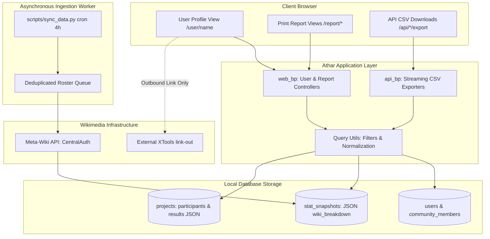

# Athar Multi-Level Export & Contributor Intelligence

* **Author:** Athar Engineering
* **Status:** Draft
* **Date:** 2026-11-03

--------------------------------------------------------------------------------

## Overview

Athar is an open-source analytics and activity tracking dashboard for regional Wikimedia affiliate user groups. While Athar currently tracks affiliate community rosters and logs activities, it lacks contributor-level intelligence and flexible data reporting. Contributors operating across multiple affiliate user groups have no unified profile showing their cross-wiki contributions or community project history. Furthermore, affiliate coordinators and grant administrators cannot export individual project dossiers, multi-year affiliate activity reports, or contributor performance portfolios in accessible formats (CSV and PDF) suited for Wikimedia Toolforge hosting.

This feature establishes an end-to-end contributor intelligence and multi-tiered reporting architecture for Athar, optimized for Wikimedia Toolforge hosting and universal internationalization (Translatewiki.net). It introduces a global Contributor Profile (`/user/<username>`) aggregating cross-wiki CentralAuth metrics and project involvement across multiple affiliate user groups. Additionally, it implements a symmetrical, three-tiered export system (Single Project, Affiliate Community, and Contributor Profile) delivered through structured CSV datasets and universal, print-optimized HTML reports designed for one-click browser PDF saving.

## The Problem

1. **Fragmented Contributor Intelligence**: A contributor active across multiple Wikimedia affiliates has their participation siloed. Clicking a contributor handle in the members table currently navigates outside the application to Meta-Wiki rather than displaying their internal project history or cross-wiki metrics.
2. **Incomplete Project Lifecycle Modeling**: The existing `Project` entity models organizers and jury members, but lacks structured fields to record participant rosters and competition results. Affiliate coordinators cannot capture or report complete activity outcomes to Wikimedia Foundation grant officers.
3. **Inflexible and Fragile Export Architecture**: Data export is currently restricted to an affiliate-wide CSV of projects. Single-project summaries and individual contributor histories cannot be exported. Furthermore, strict memory limits on Wikimedia Toolforge and complex right-to-left (RTL) Arabic typography make server-side headless browser engines (Puppeteer/Playwright) and C-dependent PDF libraries fragile, causing container crashes and font rendering defects.

## Goals

* **Global Contributor Profile**: Establish `/user/<username>` aggregating multi-affiliate memberships, cached CentralAuth metrics, and project history categorized by role (Lead Organizer, Co-organizer, Contest Jury, Participant).
* **Zero-External-Network Invariant**: Guarantee that profile and export web requests read strictly from local database snapshots, maintaining sub-second response times and eliminating Toolforge HTTP 504 gateway timeouts.
* **Sync Transparency Badge**: Provide a prominent synchronization status badge on contributor profiles indicating last synced time and next scheduled 4-hour background sync projection.
* **Schema Evolution & Volunteer Form Ergonomics**: Extend `Project` with `participants` (`List[str]`) and `results` (`Dict`) fields, supported by non-technical form controls (line-by-line / comma input) and an automated database migration script (`scripts/migrate_v2.py`).
* **Symmetrical Dual-Tier Exports**: Implement symmetrical endpoints for Single Projects, Affiliate Groups, and Contributor Profiles via CSV (with formula injection escaping) and clean print-optimized HTML templates (`@media print` for universal browser PDF export without server font bundles).
* **Universal Internationalization**: Leverage native browser typographic engines to support all world scripts (Arabic RTL, Chinese, Hindi) without bundling server-side fonts or native C-libraries.

## Non-Goals

* Real-time synchronous crawling of external XTools or MediaWiki APIs during page rendering or export requests.
* Server-side headless browser deployment (Puppeteer, Playwright) or C-dependency PDF engines on Toolforge.
* Automated wikitext web scraping of arbitrary on-wiki competition pages (replaced by structured form inputs).
* Granular historical edit slicing by arbitrary date ranges for external wiki edits (deferring to total cumulative edits per wiki recorded in CentralAuth snapshots).

## Open Questions

* None currently open; foundational trade-offs resolved during Goldfish brainstorm.

## Critical User Journeys (CUJs)

### CUJ 1: Coordinator Views and Filters a Contributor Profile
* **Given**: A contributor belongs to Wikimedia Morocco and has organized 3 workshops, judged 1 contest, and participated in 2 edit-a-thons across multiple affiliate groups.
* **When**: An affiliate coordinator navigates to `/user/ContributorName`.
* **Then**: The profile renders in under 500ms displaying their home wiki, top 5 wikis by edit count, sync timestamp badge, and a filterable project list categorized by their roles, with links to XTools for deeper external analysis.

### CUJ 2: Project Coordinator Exports Single-Project Dossier
* **Given**: An edit-a-thon has completed with 25 participants and contest results recorded in the project form.
* **When**: The coordinator opens the project detail view and clicks "Print / Save as PDF".
* **Then**: A dedicated clean report view opens (`/project/<id>/report`) formatted for A4 print with headers, description, participant roster, and podium results, triggering the browser print dialog cleanly.

### CUJ 3: Affiliate Lead Exports Annual Report
* **Given**: An affiliate group has logged activities across 2025.
* **When**: The lead visits `/export`, selects the year 2025, and chooses "Executive Report (Print / PDF)".
* **Then**: A print-ready executive summary view (`/<slug>/report?year=2025`) renders all KPIs, categorized activity tables, and partner wikis with page-break-avoidance rules for saving as PDF.

--------------------------------------------------------------------------------

## Technical Plan (Architecture)

### 1. High-Level System Architecture

Athar's architecture enforces a strict boundary between synchronous web request handling (which reads strictly from local relational storage) and asynchronous data ingestion (which interacts with external Wikimedia APIs).



### 2. Database Schema Extensions & Migration (`scripts/migrate_v2.py`)

#### Schema Additions to `app/models.py:Project`
```python
# Project schema extension
participants = db.Column(db.JSON, nullable=True)  # List[str]: ["User1", "User2"]
results = db.Column(db.JSON, nullable=True)       # Dict: {"summary": str, "winners": List[str], "metrics": dict, "notes": str}

# Indexing enhancements
lead_organizer = db.Column(db.String(128), nullable=False, index=True)
```

#### Indexing Additions to `app/models.py:StatSnapshot`
```python
__table_args__ = (
    db.Index("ix_stat_snapshots_user_recorded", "user_id", db.text("recorded_at DESC")),
)
```

#### Migration Script (`scripts/migrate_v2.py`)
An idempotent CLI script executable on local SQLite and Toolforge ToolsDB MariaDB:
```python
def run_migration():
    # Introspect table columns
    # Execute ALTER TABLE projects ADD COLUMN participants JSON NULL if missing
    # Execute ALTER TABLE projects ADD COLUMN results JSON NULL if missing
    # Create missing indexes on lead_organizer and stat_snapshots
```

### 3. Data Contracts & Volunteer Form Ergonomics

#### `Project.participants` Data Contract
* **Type:** `List[str]`
* **Validation:** Cleaned MediaWiki usernames (whitespace stripped, underscores replaced with spaces, deduplicated).
* **Form UI (`project_form.html`):** Non-technical multi-line textarea with helper text: `"أدخل أسماء المشاركين (اسم مستخدم في كل سطر أو مفصولة بفواصل)"`. Form submission parses lines/commas and serializes clean strings into `participants`.

#### `Project.results` Data Contract
* **Type:** `Dict[str, Any]`
* **Structure:**
  ```python
  {
      "summary": str,                 # Executive summary of competition outcomes
      "winners": List[str],           # Ordered list of winning usernames
      "metrics": {
          "articles_created": int,    # Total new articles created
          "articles_improved": int,   # Total existing articles edited
          "files_uploaded": int       # Total media files contributed
      },
      "notes": str                    # Additional observations or jury comments
  }
  ```
* **Form UI (`project_form.html`):** Guided sub-inputs rendered only when `is_contest` is checked or when results are toggled. Organizers fill dedicated inputs (Summary textarea, Winners textarea line-by-line, numeric metric boxes) without ever seeing or editing raw JSON. All string inputs pass through `bleach.clean()`.

### 4. Symmetrical Dual-Tier Routing Matrix

| Level / Target | Presentation & Printable Report (`web_bp`) | Data & CSV Download (`api_bp`) | Data Scope & Details |
| :--- | :--- | :--- | :--- |
| **Level 1: Single Project** | `GET /project/<int:project_id>/report` | `GET /api/projects/<int:project_id>/export?format=csv` | **Report:** Full dossier, description, jury, participants, podium results.<br>**CSV:** Roster of participants, roles, and contest metrics. |
| **Level 2: Affiliate Group** | `GET /<slug>/report` | `GET /api/<slug>/export?format=csv` | **Report:** Executive annual/monthly summary with KPIs and tables.<br>**CSV:** Filtered tabular project activity ledger. |
| **Level 3: Contributor** | `GET /user/<string:username>/report` | `GET /api/user/<string:username>/export?format=csv` | **Report:** Contributor portfolio, top-5 wikis, and project ledger.<br>**CSV:** Complete history of projects organized, judged, and attended. |

### 5. Universal HTML Print Architecture (`templates/reports/base_report.html`)

To support universal scripts (Arabic RTL, Chinese, Hindi) without bundling heavy server-side TTF fonts or C-dependent rendering engines on Toolforge:
* **Template Structure:** A dedicated `base_report.html` inheriting basic typography but omitting application navigation bars, footers, interactive sidebars, and flash toasts.
* **Print Stylesheet Standards:**
  ```css
  @page {
      size: A4 portrait;
      margin: 15mm;
  }
  @media print {
      body {
          background: #ffffff !important;
          color: #000000 !important;
          font-family: system-ui, -apple-system, 'Segoe UI', Tahoma, Arial, sans-serif;
      }
      .no-print {
          display: none !important;
      }
      .report-card, .report-table, tr, .kpi-tile {
          break-inside: avoid !important;
          page-break-inside: avoid !important;
      }
      * {
          -webkit-print-color-adjust: exact !important;
          print-color-adjust: exact !important;
      }
  }
  ```
* **Print Trigger:** Includes an on-screen action bar (`.no-print`) featuring a prominent `"🖨️ طباعة / حفظ كملف PDF"` button executing `window.print()` and an automatic trigger if `?print=1` is present in the query string.

### 6. Contributor Profile Controller Logic (`/user/<username>`)

1. **Normalization:** Input `username` is decoded via `unquote(username).replace('_', ' ').strip()`.
2. **User Lookup:** Queries local `User.query.filter(func.lower(User.username) == username.lower()).first()`.
   * *If missing locally:* Validates against MediaWiki CentralAuth using existing `check_user` logic. If valid on CentralAuth but has no affiliate activity, displays an unassociated profile state with zero projects. If not found on CentralAuth, returns 404.
3. **Metrics Aggregation:**
   * Fetches latest snapshot from `StatSnapshot.query.filter_by(user_id=user.id).order_by(StatSnapshot.recorded_at.desc()).first()`.
   * Computes top-5 wikis via `sorted(snapshot.wiki_breakdown.items(), key=lambda x: x[1], reverse=True)[:5]`.
   * Computes sync metadata badge: `last_synced` relative time string and projected next sync time (`last_synced + 4 hours`).
4. **Project History Resolution:**
   * Queries all projects where user matches `lead_organizer`, `co_organizers`, `jury_members`, or `participants`.
   * Categorizes projects into roles: Lead Organizer, Co-organizer, Contest Jury, and Participant.
   * Supports client-side filtering by affiliate group (`Community.slug`) and project date range.

### 7. Security & Ingestion Hardening

* **CSV Formula Injection Escaping:** All CSV generators iterate through cells; if any cell value begins with `=`, `+`, `-`, `@`, `\t`, or `\r`, an apostrophe (`'`) is prepended before output.
* **Streaming Responses:** API CSV endpoints stream responses chunk-by-chunk using Flask's `Response(stream_with_context(generate_csv()), mimetype='text/csv')` to avoid memory spikes on Toolforge.
* **Ingestion Deduplication (`scripts/sync_data.py`):** Ingests community rosters, builds a deduplicated `set` of usernames across all affiliates, and calls `fetch_global_stats()` exactly once per unique contributor per 4-hour cycle.
* **Reserved Slug Protection:** `slugify()` and `add_community` reject reserved slugs: `{"user", "project", "export", "api", "auth", "static", "admin"}`.


--------------------------------------------------------------------------------

## Alternatives Considered

### Alternative A: Server-Side PDF Generation Engines (WeasyPrint / ReportLab / Puppeteer)
* **Pros**:
  * Direct binary `.pdf` file downloads sent as HTTP attachments.
  * Precise server-side control over print CSS styling and page layouts.
* **Cons**:
  * High memory consumption (often >500MB) leading to Toolforge Linux kernel OOM kills.
  * Inability to handle complex multi-lingual typography (Arabic RTL ligatures, Devanagari Hindi, Chinese) without bundling large TTF font packages (~20MB+) and fragile C-dependent shaping libraries (Pango, Cairo, HarfBuzz).
  * High operational fragility and startup overhead on Toolforge container environments.
* **Reason for Rejection**: Modern browser rendering engines already provide native, high-performance font shaping and Bidi text layout for all world scripts. Using responsive HTML templates paired with `@media print` eliminates server-side memory spikes and font bundling entirely while delivering clean, one-click PDF saving for end users.

### Alternative B: Synchronous Multi-Wiki External API Crawling on Profile Load
* **Pros**:
  * Delivers live, up-to-the-minute edit counts across all language wikis for arbitrary custom date ranges.
* **Cons**:
  * High network latency: making 10 to 30 sequential HTTP calls to XTools or MediaWiki APIs takes 5–25 seconds per page view.
  * Immediate vulnerability to Toolforge reverse-proxy HTTP 504 Gateway Timeouts (which enforce a 30-second ceiling).
  * Threat of worker thread starvation: just 4–5 concurrent visitors would block all Gunicorn worker threads and take the entire tool offline.
  * Risk of external API rate-limiting (HTTP 429) from Wikimedia cloud services.
* **Reason for Rejection**: Violates Athar's core architectural invariant that synchronous web views must remain decoupled from external network latency. Reading strictly from local `StatSnapshot` tables ensures sub-second page loads with zero external failure modes. Deeper external analytics are handled via outbound links to XTools.

### Alternative C: Automated On-Wiki Competition Scraping
* **Pros**:
  * Automatically populates participant and winner rosters directly from MediaWiki pages without organizer data entry.
* **Cons**:
  * High brittleness: competition and edit-a-thon pages on Meta-Wiki and Arabic Wikipedia follow no standardized template. Page structures vary wildly between wikitext tables, subpages (e.g., `/المشاركون`), bulleted signature lists, and custom templates.
  * High maintenance overhead: scrapers break frequently upon minor wikitext edits by volunteers, resulting in silent data corruption or empty rosters.
* **Reason for Rejection**: Introducing structured form inputs in Athar provides immediate, deterministic, and error-free roster tracking for affiliate coordinators, deferring fragile wikitext scraping to a future phase.

### Alternative D: Monolithic Single-Project CSV Export
* **Pros**:
  * Maintains a single export endpoint format for all project data.
* **Cons**:
  * Flat 2D CSV cannot represent 1-to-many hierarchical structures (1 project to N organizers, M jury members, P participants, and K contest results).
  * Condensing multi-line descriptions, participant lists, and contest metrics into single cells produces mangled, unreadable spreadsheet columns and cell-overflow errors in Microsoft Excel.
* **Reason for Rejection**: Symmetrical dual-tier architecture cleanly separates concerns: the printable HTML report serves as the comprehensive hierarchical dossier, while the Level 1 CSV is specifically scoped as a structured Participant & Outcomes Roster.

--------------------------------------------------------------------------------

## Non-Functional Requirements

### Security & Privacy
* **CSV Formula Injection Mitigation**: All CSV export routines must sanitize cell values. Any field beginning with `=`, `+`, `-`, `@`, `\t`, or `\r` is prepended with a single quote (`'`) to neutralize spreadsheet macro execution in Microsoft Excel and LibreOffice Calc.
* **Cross-Site Scripting (XSS) Prevention**: All user-submitted text fields within `Project.results` (e.g., summary, notes, winner handles) and project descriptions must pass through `bleach.clean()` with an approved HTML tag and attribute whitelist prior to database persistence and HTML rendering.
* **Namespace Isolation**: The community creation and slugification routines enforce a strict reserved keyword blocklist (`user`, `project`, `export`, `api`, `auth`, `static`, `admin`) to prevent URL route collisions with core platform endpoints.

### Performance & Latency
* **Sub-Second Web Rendering**: All `/user/<username>` and report routes must execute within <500ms by reading strictly from local indexed database tables. Zero outbound HTTP requests are permitted during web requests.
* **Memory-Efficient Streaming**: CSV exports must stream rows chunk-by-chunk using `Response(stream_with_context(...))` rather than buffering full datasets in server memory (`io.StringIO`), ensuring low memory consumption on Toolforge.
* **Database Indexing**: The `projects.lead_organizer` column must be indexed (`index=True`), and a composite index `(user_id, recorded_at DESC)` must be added to `stat_snapshots` to eliminate full table scans.

### Rollout & Rollback Safety
* **Database Backward Compatibility**: The schema changes add nullable JSON columns (`participants`, `results`) to the `projects` table. Existing queries and views that do not reference these columns will continue functioning without interruption.
* **Idempotent Migration**: The migration script (`scripts/migrate_v2.py`) inspects existing table metadata before executing DDL commands, allowing it to be safely re-run across SQLite and MariaDB without failing on existing columns.
* **Rollback Plan**: If a rollback is required, application code can be reverted to previous commits without needing to drop the new columns, as both `participants` and `results` default to `NULL`.


--------------------------------------------------------------------------------

## Detailed Implementation Plan

### Target Files to Create/Modify

#### 1. `app/models.py` (Modify)
* **Type / Scope**: Database Schema & Domain Entities
* **Proposed Changes**:
  * Add `participants = db.Column(db.JSON, nullable=True)` to `Project` model storing a homogeneous `List[str]` of participant usernames.
  * Add `results = db.Column(db.JSON, nullable=True)` to `Project` model storing a structured dictionary (`{"summary": str, "winners": List[str], "metrics": dict, "notes": str}`).
  * Update `Project.lead_organizer` definition to include `index=True` for accelerated contributor project lookups.
  * Add composite index `Index("ix_stat_snapshots_user_recorded", "user_id", db.text("recorded_at DESC"))` to `StatSnapshot`.
  * Update `Project.to_dict()` to include serialized `participants` and `results`.

#### 2. `scripts/migrate_v2.py` (Create)
* **Type / Scope**: Standalone Database Migration Script
* **Proposed Changes**:
  * Implement an idempotent migration runner inspecting existing table columns via SQLAlchemy `inspect(db.engine)`.
  * Execute `ALTER TABLE projects ADD COLUMN participants JSON NULL` if not present.
  * Execute `ALTER TABLE projects ADD COLUMN results JSON NULL` if not present.
  * Conditionally create indexes on `projects.lead_organizer` and `stat_snapshots` if missing.
  * Compatible across both SQLite and MariaDB 10.x / ToolsDB environments.

#### 3. `app/query_utils.py` (Create)
* **Type / Scope**: Shared Query & Formatting Utilities
* **Proposed Changes**:
  * Extract and centralize `filter_projects_by_date(query, args)` from `api.py` so both `web.py` and `api.py` share identical filtering semantics.
  * Implement `sanitize_csv_cell(value)` to prepend an apostrophe (`'`) to any string starting with `=`, `+`, `-`, `@`, `\t`, or `\r`.
  * Implement `normalize_username(username)` to decode URL entities, replace underscores with spaces, and strip surrounding whitespace.

#### 4. `app/routes/web.py` (Modify)
* **Type / Scope**: Flask Presentation Routes & Form Handlers
* **Proposed Changes**:
  * Implement `GET /user/<string:username>`: Global contributor profile controller rendering cached `StatSnapshot` data, local top-5 wikis, sync transparency badge, multi-affiliate memberships, and role-categorized projects with client-side filtering.
  * Implement `GET /project/<int:project_id>/report`: Renders printable single-project dossier (`project_report.html`).
  * Implement `GET /<slug>/report`: Renders printable affiliate executive annual/monthly report (`community_report.html`).
  * Implement `GET /user/<string:username>/report`: Renders printable contributor portfolio report (`user_report.html`).
  * Update `create_project` and `edit_project` form handlers to parse `participants` (textarea lines/commas) and structured `results` sub-fields with Bleach HTML sanitization.
  * Update `slugify()` and `add_community` to reject reserved keywords (`user`, `project`, `export`, `api`, `auth`, `static`, `admin`).

#### 5. `app/routes/api.py` (Modify)
* **Type / Scope**: REST API & CSV Data Export Endpoints
* **Proposed Changes**:
  * Update `create_projetct` and `update_project` endpoints to accept and validate `participants: List[str]` and `results: Dict`.
  * Implement `GET /api/projects/<int:project_id>/export?format=csv`: Streams a flat participant roster and outcome metrics CSV with formula injection protection.
  * Implement `GET /api/user/<string:username>/export?format=csv`: Streams a complete history of projects where the contributor organized, judged, or participated.
  * Refactor `exp_community_projects` to use chunked streaming with Flask's `stream_with_context` and apply `sanitize_csv_cell` across all exported columns.

#### 6. `app/templates/reports/base_report.html` (Create)
* **Type / Scope**: Minimal Print-Optimized Layout Template
* **Proposed Changes**:
  * Define standalone HTML layout omitting global navigation bars, footers, and flash messages.
  * Embed standard `@media print` CSS rules: `@page { size: A4 portrait; margin: 15mm; }`, `-webkit-print-color-adjust: exact;`, and `break-inside: avoid;`.
  * Include a top `.no-print` action bar with a prominent "🖨️ طباعة / حفظ كملف PDF" button executing `window.print()` and auto-print trigger for `?print=1`.

#### 7. `app/templates/reports/project_report.html` (Create)
* **Type / Scope**: Printable Single-Project Dossier Template
* **Proposed Changes**:
  * Renders project header, status badge, metadata grid, sanitized HTML description, organizer/jury lists, participant roster, and competition podium results.

#### 8. `app/templates/reports/community_report.html` (Create)
* **Type / Scope**: Printable Affiliate Executive Report Template
* **Proposed Changes**:
  * Renders affiliate header, active filter range, KPI cards (total members, edits, projects), partner wiki breakdown, and categorized activity summary table.

#### 9. `app/templates/reports/user_report.html` (Create)
* **Type / Scope**: Printable Contributor Dossier Template
* **Proposed Changes**:
  * Renders contributor overview, home wiki, top 5 wikis table, affiliate user group memberships, and itemized project participation ledger.

#### 10. `app/templates/user_profile.html` (Create)
* **Type / Scope**: Interactive Contributor Profile Template
* **Proposed Changes**:
  * Renders contributor profile header, sync metadata badge (last updated, next 4-hour cycle), KPI cards, top-5 wikis table with external links to XTools, affiliate dropdown filter, role segmented project tabs, and export action buttons ("تصدير تقرير PDF / طباعة", "تصدير CSV").

#### 11. `app/templates/users.html` (Modify)
* **Type / Scope**: Community Members List Template
* **Proposed Changes**:
  * Update table username links to point to the internal `/user/<username>` route instead of directly navigating away to Meta-Wiki, while retaining an external link icon.

#### 12. `app/templates/project_detail.html` (Modify)
* **Type / Scope**: Single Project Detail Template
* **Proposed Changes**:
  * Add "طباعة تقرير PDF" and "تصدير المشاركين CSV" export buttons to the header action bar.
  * Add participant list section and competition outcomes/podium results block.

#### 13. `app/templates/project_form.html` (Modify)
* **Type / Scope**: Project Creation and Edit Form Template
* **Proposed Changes**:
  * Add textarea for `participants` with Arabic helper text.
  * Add structured result fields (Summary, Winners line-by-line, Articles Created, Articles Improved, Files Uploaded, Notes) toggled when `is_contest` is checked or results are entered.

#### 14. `app/templates/export.html` (Modify)
* **Type / Scope**: Export Center Template
* **Proposed Changes**:
  * Add dual export cards allowing users to choose between downloading a raw CSV dataset or opening the printable HTML executive report for saving to PDF.

#### 15. `scripts/sync_data.py` (Modify)
* **Type / Scope**: Background Synchronization Job
* **Proposed Changes**:
  * Ingest all community rosters first and construct a deduplicated `set` of usernames.
  * Query CentralAuth (`fetch_global_stats`) exactly once per unique contributor per 4-hour cycle, eliminating redundant API requests for multi-group members.

#### 16. `tests/test_user_profile.py` (Create)
* **Type / Scope**: Route & Profile Integration Tests
* **Proposed Changes**:
  * Verify `/user/<username>` renders correctly for valid users with cached stats and projects.
  * Verify username normalization (spaces vs underscores vs encoded entities).
  * Verify 404 behavior for non-existent users and unassociated handling for users without local projects.
  * Verify project role categorization (lead, co-org, jury, participant).

#### 17. `tests/test_exports_v2.py` (Create)
* **Type / Scope**: Multi-Level Export Unit & Security Tests
* **Proposed Changes**:
  * Verify Level 1, 2, and 3 CSV exports stream valid UTF-8 BOM data.
  * Verify CSV formula injection escaping (cells starting with `=`, `+`, `-`, `@` are prepended with `'`).
  * Verify Level 1, 2, and 3 printable HTML report routes return 200 OK with proper print CSS rules.

#### 18. `tests/test_migration.py` (Create)
* **Type / Scope**: Database Migration Test
* **Proposed Changes**:
  * Verify `scripts/migrate_v2.py` adds `participants` and `results` columns to existing SQLite databases idempotently without data loss.

#### 19. Documentation Contracts (`README.md`, `app/README.md`, `app/routes/README.md`, `scripts/README.md`) (Modify)
* **Type / Scope**: EGM Blueprints & Package Contracts
* **Proposed Changes**:
  * Update interfaces, invariants, and side effects across all four contract files to document new routes, models, migration scripts, and export capabilities.

### Verification Plan

* **Unit & Route Tests**:
  * Execute: `./venv/bin/pytest tests/test_user_profile.py tests/test_exports_v2.py tests/test_migration.py`
  * Verify all 48 existing regression tests and all new tests pass cleanly with zero failures.
* **Database Migration Verification**:
  * Run `python3 scripts/migrate_v2.py` against a populated development database (`instance/dev.db`) and verify table schemas using `sqlite3`.
* **Export Security Verification**:
  * Assert that test project entries with malicious formula payloads (e.g., `=cmd|' /C calc'!A0`) have leading single quotes applied in CSV output.
* **Browser Print & PDF Verification**:
  * Open `/project/1/report?print=1`, `/<slug>/report`, and `/user/<username>/report` in a browser; verify clean RTL layout, absence of navigation bars, contrast preservation, and A4 page break compliance in print preview.
