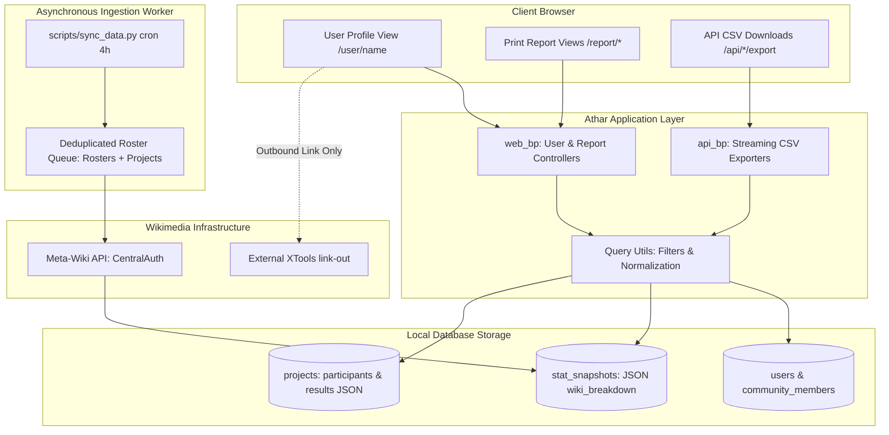

# Athar Multi-Level Export & Contributor Intelligence

* **Author:** Athar Engineering
* **Status:** Proposed
* **Date:** 2026-11-03

--------------------------------------------------------------------------------

## Overview

Athar is an open-source analytics and activity tracking dashboard for regional Wikimedia affiliate user groups. While Athar currently tracks affiliate community rosters and logs activities, it lacks contributor-level profiles and flexible data reporting. Contributors operating across multiple affiliate user groups have no unified profile showing their cross-wiki contributions or community project history. Furthermore, affiliate coordinators and grant administrators cannot export individual project dossiers, multi-year affiliate activity reports, or contributor performance portfolios in accessible formats (CSV and PDF) suited for Wikimedia Toolforge hosting.

This feature establishes a contributor profile and reporting architecture for Athar, optimized for Wikimedia Toolforge hosting and universal internationalization (Translatewiki.net). It introduces a global Contributor Profile (`/user/<username>`) aggregating cross-wiki CentralAuth metrics and project involvement across multiple affiliate user groups. Additionally, it implements 3 export scopes (Single Project, Affiliate Community, and Contributor Profile) delivered through 2 formats: structured CSV datasets and universal, print-optimized HTML reports designed for one-click browser PDF saving.

## The Problem

1. **Fragmented Contributor Profiles**: A contributor active across multiple Wikimedia affiliates has their participation siloed. Clicking a contributor handle in the members table currently navigates outside the application to Meta-Wiki rather than displaying their internal project history or cross-wiki metrics.
2. **Incomplete Project Lifecycle Modeling**: The existing `Project` entity models organizers and jury members, but lacks structured fields to record participant rosters and competition results. Affiliate coordinators cannot capture or report complete activity outcomes to Wikimedia Foundation grant officers.
3. **Inflexible and Fragile Export Architecture**: Data export is currently restricted to an affiliate-wide CSV of projects. Single-project summaries and individual contributor histories cannot be exported. Furthermore, strict memory limits on Wikimedia Toolforge and complex right-to-left (RTL) Arabic typography make server-side headless browser engines (Puppeteer/Playwright) and C-dependent PDF libraries fragile, causing container crashes and font rendering defects.

## Goals

* **Global Contributor Profile**: Establish `/user/<username>` aggregating multi-affiliate memberships, cached CentralAuth metrics, and project history categorized by role (Lead Organizer, Co-organizer, Contest Jury, Participant).
* **Zero-External-Network Invariant**: Guarantee that profile and export web requests read strictly from local database snapshots, maintaining sub-second response times (<500ms) and eliminating Toolforge HTTP 504 gateway timeouts.
* **Sync Transparency Badge**: Provide a prominent synchronization status badge on contributor profiles indicating factual relative elapsed time since the last background sync snapshot (e.g., "تم التحديث قبل ساعتين").
* **Schema Evolution & Volunteer Form Ergonomics**: Extend `Project` with `participants` (`List[str]`) and `results` (`Dict`) fields, supported by non-technical form controls (line-by-line / comma input) and an automated database migration script (`scripts/migrate_v2.py`).
* **Symmetrical Multi-Scope Exports**: Implement symmetrical endpoints for Single Projects, Affiliate Groups, and Contributor Profiles via CSV (with formula injection escaping) and clean print-optimized HTML templates (`@media print` for universal browser PDF export without server font bundles).
* **Universal Internationalization**: Leverage native browser typographic engines to support all world scripts (Arabic RTL, Chinese, Hindi) without bundling server-side fonts or native C-libraries.

## Non-Goals

* Real-time synchronous crawling of external XTools or MediaWiki APIs during page rendering or export requests.
* Server-side headless browser deployment (Puppeteer, Playwright) or C-dependency PDF engines on Toolforge.
* Automated wikitext web scraping of arbitrary on-wiki competition pages (replaced by structured form inputs).
* Granular historical edit slicing by arbitrary date ranges for external wiki edits (deferring to total cumulative edits per wiki recorded in CentralAuth snapshots).

## Open Questions

* None.

## Critical User Journeys (CUJs)

### CUJ 1: Coordinator Views and Filters a Contributor Profile
* **Given**: A contributor belongs to Wikimedia Morocco and has organized 3 workshops, judged 1 contest, and participated in 2 edit-a-thons across multiple affiliate groups.
* **When**: An affiliate coordinator navigates to `/user/ContributorName`.
* **Then**: The profile renders in under 500ms displaying their home wiki, top 5 wikis by edit count, factual sync timestamp badge, and a filterable project list categorized by their roles, with links to XTools for deeper external analysis.

### CUJ 2: Project Coordinator Exports Single-Project Dossier
* **Given**: An edit-a-thon has completed with 25 participants and contest results recorded in the project form.
* **When**: The coordinator opens the project detail view and clicks "Print / Save as PDF".
* **Then**: A dedicated clean report view opens (`/project/<id>/report`) formatted for A4 print with headers, description, participant roster, and podium results, triggering the browser print dialog cleanly.

### CUJ 3: Affiliate Lead Exports Annual Report
* **Given**: An affiliate group has logged activities across 2025.
* **When**: The lead visits `/export`, selects the year 2025, and chooses "Executive Report (Print / PDF)".
* **Then**: A print-ready executive summary view (`/<slug>/report?year=2025`) renders all KPIs, categorized activity tables, and partner wikis with page-break-avoidance rules for saving as PDF.

--------------------------------------------------------------------------------

## Technical Plan (Architecture)

### 1. High-Level System Architecture

Athar's architecture enforces a strict boundary between synchronous web request handling (which reads strictly from local relational storage) and asynchronous data ingestion (which interacts with external Wikimedia APIs).



### 2. Database Schema Extensions & Migration (`scripts/migrate_v2.py`)

#### Schema Additions to `app/models.py:Project`
```python
# Project schema extension
participants = db.Column(db.JSON, nullable=True)  # List[str]: ["User1", "User2"]
results = db.Column(db.JSON, nullable=True)       # Dict: {"summary": str, "winners": List[str], "metrics": dict, "notes": str}

# Indexing enhancements
lead_organizer = db.Column(db.String(128), nullable=False, index=True)
```

#### Indexing Additions to `app/models.py:StatSnapshot`
```python
__table_args__ = (
    db.Index("ix_stat_snapshots_user_recorded", "user_id", db.text("recorded_at DESC")),
)
```

#### Migration Script (`scripts/migrate_v2.py`)
An idempotent CLI script executable on local SQLite and Toolforge ToolsDB MariaDB:
```python
def run_migration():
    # Introspect table columns via SQLAlchemy inspect(db.engine)
    # Execute ALTER TABLE projects ADD COLUMN participants JSON NULL if missing
    # Execute ALTER TABLE projects ADD COLUMN results JSON NULL if missing
    # Conditionally create missing indexes on lead_organizer and stat_snapshots
```

### 3. Data Contracts & Volunteer Form Ergonomics

#### `Project.participants` Data Contract
* **Type:** `List[str]`
* **Validation:** Cleaned MediaWiki usernames (whitespace stripped, underscores replaced with spaces, deduplicated).
* **Form UI (`project_form.html`):** Non-technical multi-line textarea with helper text: `"أدخل أسماء المشاركين (اسم مستخدم في كل سطر أو مفصولة بفواصل)"`. Form submission parses lines/commas and serializes clean strings into `participants`.

#### `Project.results` Data Contract
* **Type:** `Dict[str, Any]`
* **Structure:**
  ```python
  {
      "summary": str,                 # Executive summary of competition outcomes
      "winners": List[str],           # Ordered list of winning usernames
      "metrics": {
          "articles_created": int,    # Total new articles created
          "articles_improved": int,   # Total existing articles edited
          "files_uploaded": int       # Total media files contributed
      },
      "notes": str                    # Additional observations or jury comments
  }
  ```
* **Form Field Names & Deserialization (`web.py`):**
  * `results_summary`: Textarea for executive summary (`bleach.clean(request.form.get('results_summary', ''))`).
  * `results_winners`: Textarea for winning usernames, parsed line-by-line / comma-separated into `List[str]`.
  * `results_articles_created`: Integer input (`int(request.form.get('results_articles_created') or 0)`).
  * `results_articles_improved`: Integer input (`int(request.form.get('results_articles_improved') or 0)`).
  * `results_files_uploaded`: Integer input (`int(request.form.get('results_files_uploaded') or 0)`).
  * `results_notes`: Textarea for jury comments and observations (`bleach.clean(...)`).
  * Organizers fill dedicated form controls without seeing raw JSON. All text fields pass through `bleach.clean()`.

### 4. Symmetrical Multi-Scope Routing Matrix

| Level / Target | Presentation & Printable Report (`web_bp`) | Data & CSV Download (`api_bp`) | CSV Columns & Data Scope |
| :--- | :--- | :--- | :--- |
| **Level 1: Single Project** | `GET /project/<int:project_id>/report` | `GET /api/projects/<int:project_id>/export?format=csv` | **Headers:** `["اسم المستخدم", "الدور في النشاط", "عنوان النشاط", "المشروع المستهدف", "تاريخ البدء", "تاريخ الانتهاء"]`<br>**Report:** Full dossier, description, jury, participants, podium results. |
| **Level 2: Affiliate Group** | `GET /<slug>/report` | `GET /api/<slug>/export?format=csv` | **Headers:** `["معرف النشاط", "عنوان النشاط", "المجتمع التابع له", "المشروع المستهدف", "المنظم الرئيسي", "تاريخ البدء", "تاريخ الانتهاء", "الحالة", "مسابقة"]`<br>**Report:** Executive annual/monthly summary with KPIs and tables. |
| **Level 3: Contributor** | `GET /user/<string:username>/report` | `GET /api/users/<string:username>/export?format=csv` *(alias `/api/user/<username>/export`)* | **Headers:** `["معرف النشاط", "عنوان النشاط", "المجتمع التابع له", "الدور", "الحالة", "المشروع المستهدف", "تاريخ البدء", "تاريخ الانتهاء"]`<br>**Report:** Contributor portfolio, top-5 wikis, and project ledger. |

### 5. Universal HTML Print Architecture (`templates/reports/base_report.html`)

To support universal scripts (Arabic RTL, Chinese, Hindi) without bundling heavy server-side TTF fonts or C-dependent rendering engines on Toolforge:
* **Template Structure:** A dedicated `base_report.html` inheriting basic typography but omitting application navigation bars, footers, interactive sidebars, and flash toasts.
* **Print Stylesheet Standards:**
  ```css
  @page {
      size: A4 portrait;
      margin: 15mm;
  }
  @media print {
      body {
          background: #ffffff !important;
          color: #000000 !important;
          font-family: system-ui, -apple-system, 'Segoe UI', Tahoma, Arial, sans-serif;
      }
      .no-print {
          display: none !important;
      }
      .report-card, tr, .kpi-tile {
          break-inside: avoid !important;
          page-break-inside: avoid !important;
      }
      * {
          -webkit-print-color-adjust: exact !important;
          print-color-adjust: exact !important;
      }
  }
  ```
  *(Note: `break-inside: avoid` is omitted from `.report-table` to ensure multi-page tables paginate cleanly without row clipping).*
* **Print Trigger:** Includes an on-screen action bar (`.no-print`) featuring a prominent `"🖨️ طباعة / حفظ كملف PDF"` button executing `window.print()` and an automatic trigger if `?print=1` is present in the query string.

### 6. Contributor Profile Controller Logic (`/user/<username>`)

1. **Normalization:** Input `username` is decoded via `unquote(username).replace('_', ' ').strip()`.
2. **User Lookup (Zero-External-Network Invariant):**
   * Queries local `User.query.filter(func.lower(User.username) == username.lower()).first()`.
   * *If missing in User table:* Checks if the username appears in any `Project` role (`lead_organizer`, `co_organizers`, `jury_members`, or `participants`). If present in projects, renders profile in an unassociated affiliate state displaying their project history.
   * *If completely absent from all local tables:* Returns an immediate HTTP 404 without external network queries. This preserves sub-second response times and eliminates Toolforge Gunicorn worker starvation.
3. **Metrics Aggregation:**
   * Fetches latest snapshot from `StatSnapshot.query.filter_by(user_id=user.id).order_by(StatSnapshot.recorded_at.desc()).first()`.
   * Computes top-5 wikis via `sorted(snapshot.wiki_breakdown.items(), key=lambda x: x[1], reverse=True)[:5]`.
   * Computes sync metadata badge: factual relative elapsed time (e.g. "تم التحديث قبل ساعتين") based on `StatSnapshot.recorded_at` or `User.last_synced`.
4. **Project History Resolution (Cross-Dialect Portability):**
   * To prevent SQLite vs. MariaDB SQL JSON query divergence, projects are resolved via fast in-memory Python filtering:
     ```python
     candidate_projects = Project.query.order_by(Project.start_date.desc()).all()
     user_projects = [
         p for p in candidate_projects
         if username == p.lead_organizer
         or (p.co_organizers and username in p.co_organizers)
         or (p.jury_members and username in p.jury_members)
         or (p.participants and username in p.participants)
     ]
     ```
   * Categorizes projects into roles: Lead Organizer, Co-organizer, Contest Jury, and Participant.
   * Supports client-side filtering by affiliate group (`Community.slug`) and project date range.

### 7. Security & Ingestion Hardening

* **Complete CSV Formula Injection Escaping:** All CSV generators iterate through cells using `sanitize_csv_cell()`. Strips leading whitespace before checking for formula trigger characters:
  ```python
  def sanitize_csv_cell(value: Any) -> Any:
      if not isinstance(value, str):
          return value
      stripped = value.lstrip()
      if stripped and stripped[0] in ("=", "+", "-", "@", "|", "\t", "\r"):
          return "'" + value
      return value
  ```
* **Streaming Responses:** API CSV endpoints stream responses chunk-by-chunk using Flask's `Response(stream_with_context(generate_csv()), mimetype='text/csv')` with a UTF-8 BOM (`\ufeff`) to ensure clean rendering in Microsoft Excel without memory buffering on Toolforge.
* **Ingestion Deduplication & Scope (`scripts/sync_data.py`):**
  * Discovers unique usernames by combining `User` roster records with all distinct usernames extracted from `Project.lead_organizer`, `Project.co_organizers`, `Project.jury_members`, and `Project.participants`.
  * Enforces a 4-hour freshness check (`user.last_synced` within the last 4 hours) in `sync_community()` to eliminate redundant CentralAuth API queries.
* **Reserved Slug Protection:** `slugify()` and `add_community` reject reserved slugs: `{"user", "project", "export", "api", "auth", "static", "admin"}`.

--------------------------------------------------------------------------------

## Alternatives Considered

### Alternative A: Server-Side PDF Generation Engines (WeasyPrint / ReportLab / Puppeteer)
* **Pros**:
  * Direct binary `.pdf` file downloads sent as HTTP attachments.
  * Precise server-side control over print CSS styling and page layouts.
* **Cons**:
  * High memory consumption (often >500MB) leading to Toolforge Linux kernel OOM kills.
  * Inability to handle complex multi-lingual typography (Arabic RTL ligatures, Devanagari Hindi, Chinese) without bundling large TTF font packages (~20MB+) and fragile C-dependent shaping libraries (Pango, Cairo, HarfBuzz).
  * High operational fragility and startup overhead on Toolforge container environments.
* **Reason for Rejection**: Modern browser rendering engines already provide native, high-performance font shaping and Bidi text layout for all world scripts. Using responsive HTML templates paired with `@media print` eliminates server-side memory spikes and font bundling entirely while delivering clean, one-click PDF saving for end users.

### Alternative B: Synchronous Multi-Wiki External API Crawling on Profile Load
* **Pros**:
  * Delivers live, up-to-the-minute edit counts across all language wikis for arbitrary custom date ranges.
* **Cons**:
  * High network latency: making 10 to 30 sequential HTTP calls to XTools or MediaWiki APIs takes 5–25 seconds per page view.
  * Immediate vulnerability to Toolforge reverse-proxy HTTP 504 Gateway Timeouts (which enforce a 30-second ceiling).
  * Threat of worker thread starvation: just 4–5 concurrent visitors would block all Gunicorn worker threads and take the entire tool offline.
  * Risk of external API rate-limiting (HTTP 429) from Wikimedia cloud services.
* **Reason for Rejection**: Violates Athar's core architectural invariant that synchronous web views must remain decoupled from external network latency. Reading strictly from local `StatSnapshot` tables ensures sub-second page loads with zero external failure modes. Deeper external analytics are handled via outbound links to XTools.

### Alternative C: Automated On-Wiki Competition Scraping
* **Pros**:
  * Automatically populates participant and winner rosters directly from MediaWiki pages without organizer data entry.
* **Cons**:
  * High brittleness: competition and edit-a-thon pages on Meta-Wiki and Arabic Wikipedia follow no standardized template. Page structures vary wildly between wikitext tables, subpages (e.g., `/المشاركون`), bulleted signature lists, and custom templates.
  * High maintenance overhead: scrapers break frequently upon minor wikitext edits by volunteers, resulting in silent data corruption or empty rosters.
* **Reason for Rejection**: Introducing structured form inputs in Athar provides immediate, deterministic, and error-free roster tracking for affiliate coordinators, deferring fragile wikitext scraping to a future phase.

### Alternative D: Monolithic Single-Project CSV Export
* **Pros**:
  * Maintains a single export endpoint format for all project data.
* **Cons**:
  * Flat 2D CSV cannot represent 1-to-many hierarchical structures (1 project to N organizers, M jury members, P participants, and K contest results).
  * Condensing multi-line descriptions, participant lists, and contest metrics into single cells produces mangled, unreadable spreadsheet columns and cell-overflow errors in Microsoft Excel.
* **Reason for Rejection**: Cleanly separates concerns: the printable HTML report serves as the comprehensive hierarchical dossier, while the Level 1 CSV is specifically scoped as a structured Participant & Outcomes Roster.

### Alternative E: Normalized Relational Junction Table (`ProjectParticipant`)
* **Pros**:
  * Allows native SQL `JOIN` operations and standard relational foreign key constraints.
  * Direct indexing on individual participant usernames in relational storage.
* **Cons**:
  * Requires complex relational migrations and cascading deletion handling across existing SQLite and Toolforge MariaDB databases.
  * Increases write complexity and transaction overhead for simple volunteer edit forms.
  * Over-engineers a dataset where typical project participant rosters range between 5 and 50 usernames.
* **Reason for Rejection**: Storing participant lists and competition podium summaries as lightweight denormalized JSON columns (`Project.participants` and `Project.results`) matches Athar's existing schema patterns (such as `StatSnapshot.wiki_breakdown`), provides maximum schema flexibility, and enables safe idempotent DDL migrations on Toolforge without multi-table relational lock contention.

--------------------------------------------------------------------------------

## Non-Functional Requirements

### Security & Privacy
* **Complete CSV Formula Injection Mitigation**: All CSV export routines sanitize cell values via `sanitize_csv_cell()`. Any field beginning with `=`, `+`, `-`, `@`, `|`, `\t`, or `\r` (after stripping leading whitespace) is prepended with a single quote (`'`) to neutralize spreadsheet macro execution in Microsoft Excel and LibreOffice Calc.
* **Cross-Site Scripting (XSS) Prevention**: All user-submitted text fields within `Project.results` (summary, notes, winner handles) and project descriptions must pass through `bleach.clean()` with an approved HTML tag and attribute whitelist prior to database persistence and HTML rendering.
* **Namespace Isolation**: The community creation and slugification routines enforce a strict reserved keyword blocklist (`user`, `project`, `export`, `api`, `auth`, `static`, `admin`) to prevent URL route collisions with core platform endpoints.

### Performance & Latency
* **Sub-Second Web Rendering**: All `/user/<username>` and report routes must execute within <500ms by reading strictly from local indexed database tables. Zero outbound HTTP requests are permitted during web requests.
* **Memory-Efficient Streaming**: CSV exports must stream rows chunk-by-chunk using `Response(stream_with_context(...))` rather than buffering full datasets in server memory (`io.StringIO`), ensuring low memory consumption on Toolforge.
* **Database Indexing**: The `projects.lead_organizer` column must be indexed (`index=True`), and a composite index `(user_id, recorded_at DESC)` must be added to `stat_snapshots` to eliminate full table scans.

### Rollout & Rollback Safety
* **Database Backward Compatibility**: The schema changes add nullable JSON columns (`participants`, `results`) to the `projects` table. Existing queries and views that do not reference these columns will continue functioning without interruption.
* **Idempotent Migration**: The migration script (`scripts/migrate_v2.py`) inspects existing table metadata before executing DDL commands, allowing it to be safely re-run across SQLite and MariaDB without failing on existing columns.
* **Rollback Plan**: If a rollback is required, application code can be reverted to previous commits without needing to drop the new columns, as both `participants` and `results` default to `NULL`.

--------------------------------------------------------------------------------

## Risks & Mitigations

| Risk | Impact | Mitigation Strategy |
| :--- | :--- | :--- |
| **Wikimedia CentralAuth API Rate-Limiting (HTTP 429)** | Ingestion job stalls or fails during background updates. | Deduplicate all usernames into a single global set across rosters and projects before polling; enforce a 4-hour `last_synced` freshness threshold. |
| **Toolforge MariaDB Connection Drops** | HTTP 500 errors during long-running streaming or cron runs. | Enable SQLAlchemy pool recycling (`pool_recycle=280`, `pool_pre_ping=True`) in database configuration. |
| **Worker Memory Spikes during Large CSV Exports** | Toolforge Linux OOM kills Gunicorn worker processes. | Use Flask `stream_with_context` with generator yield chunks instead of loading entire datasets into `io.StringIO` buffers. |
| **Malformed Volunteer Inputs in Results/Participants** | Application crashes or corrupted JSON during rendering. | Strip surrounding whitespace, normalize MediaWiki underscores, enforce structured HTML sub-inputs, and sanitize text with `bleach.clean()`. |

--------------------------------------------------------------------------------

## Detailed Implementation Plan

The implementation is structured into 5 sequential phases, each concluding with an automated testing checkpoint to guarantee stability and prevent regressions.

### Phase 1: Domain Entities & Migration Tooling

Focus: Database model extensions, indexes, and idempotent schema migration scripts.

#### 1. `app/models.py` (Modify)
* **Scope**: Database Schema & Domain Entities
* **Changes**:
  * Add `participants = db.Column(db.JSON, nullable=True)` to `Project` model storing a homogeneous `List[str]` of participant usernames.
  * Add `results = db.Column(db.JSON, nullable=True)` to `Project` model storing a structured dictionary (`{"summary": str, "winners": List[str], "metrics": dict, "notes": str}`).
  * Update `Project.lead_organizer` definition to include `index=True` for accelerated contributor project lookups.
  * Add composite index `Index("ix_stat_snapshots_user_recorded", "user_id", db.text("recorded_at DESC"))` to `StatSnapshot`.
  * Update `Project.to_dict()` to include serialized `participants` and `results`.

#### 2. `scripts/migrate_v2.py` (Create)
* **Scope**: Standalone Database Migration Script
* **Changes**:
  * Implement an idempotent migration runner inspecting existing table columns via SQLAlchemy `inspect(db.engine)`.
  * Execute `ALTER TABLE projects ADD COLUMN participants JSON NULL` if missing.
  * Execute `ALTER TABLE projects ADD COLUMN results JSON NULL` if missing.
  * Conditionally create indexes on `projects.lead_organizer` and `stat_snapshots` if missing.
  * Support both SQLite and MariaDB 10.x / ToolsDB environments.

#### 3. `tests/test_migration.py` (Create)
* **Scope**: Migration Test Suite
* **Changes**:
  * Verify `scripts/migrate_v2.py` idempotently applies schema alterations to SQLite databases without data loss or exceptions on repeated runs.

> **Phase 1 Checkpoint**: Run `./venv/bin/pytest tests/test_migration.py` and verify database schema integrity.

---

### Phase 2: Core Utilities & Ingestion Optimization

Focus: Query filtering, URL building, formula injection sanitization, and deduplicated background synchronization.

#### 4. `app/wiki_utils.py` (Modify)
* **Scope**: Wikimedia Integration Helpers
* **Changes**:
  * Implement `build_xtools_user_url(wiki_code: str, username: str) -> str`: Centralized helper returning `f"https://xtools.wmcloud.org/ec/{wiki_code}/{quote(username)}"`.

#### 5. `app/query_utils.py` (Create)
* **Scope**: Shared Query & Formatting Utilities
* **Changes**:
  * Implement `filter_projects_by_date(query, args)` to unify date range filtering between `web.py` and `api.py`.
  * Implement `sanitize_csv_cell(value: Any) -> Any` with `.lstrip()` and trigger check `("=", "+", "-", "@", "|", "\t", "\r")`.
  * Implement `normalize_username(username: str) -> str` to decode URL entities, convert underscores to spaces, and strip whitespace.

#### 6. `scripts/sync_data.py` (Modify)
* **Scope**: Background Synchronization Job
* **Changes**:
  * Discover unique usernames across both `User` rosters and all distinct usernames in `Project.lead_organizer`, `Project.co_organizers`, `Project.jury_members`, and `Project.participants`.
  * In `sync_community()`, skip CentralAuth queries if `user.last_synced` is within the last 4 hours.

> **Phase 2 Checkpoint**: Run `./venv/bin/pytest tests/test_sync.py` and verify deduplication and synchronization caching.

---

### Phase 3: Presentation Routes & Form Handlers

Focus: Contributor profile route, project form ergonomics, results deserialization, and reserved slug protection.

#### 7. `app/routes/web.py` (Modify)
* **Scope**: Flask Presentation Routes & Form Handlers
* **Changes**:
  * Implement `GET /user/<string:username>`: Reads strictly from local storage, performs in-memory Python role filtering, returns 404 if user has no Athar presence.
  * Update `create_project` and `edit_project` form handlers to parse `participants` and structured `results` sub-fields (`results_summary`, `results_winners`, `results_articles_created`, `results_articles_improved`, `results_files_uploaded`, `results_notes`) with Bleach HTML sanitization.
  * Update `slugify()` and `add_community` to reject reserved slugs (`user`, `project`, `export`, `api`, `auth`, `static`, `admin`).

#### 8. `app/templates/project_form.html` (Modify)
* **Scope**: Project Creation and Edit Form Template
* **Changes**:
  * Add textarea for `participants` with line-by-line / comma input helper text.
  * Add structured result inputs (`results_summary`, `results_winners`, `results_articles_created`, `results_articles_improved`, `results_files_uploaded`, `results_notes`) toggled when `is_contest` is checked or results are populated.

#### 9. `app/templates/project_detail.html` (Modify)
* **Scope**: Single Project Detail Template
* **Changes**:
  * Add "طباعة تقرير PDF" and "تصدير المشاركين CSV" export buttons to the header action bar.
  * Add participant roster section and competition podium results block.

#### 10. `app/templates/users.html` (Modify)
* **Scope**: Community Members List Template
* **Changes**:
  * Update username table links to navigate to the internal `/user/<username>` route while preserving external link icon.

> **Phase 3 Checkpoint**: Run `./venv/bin/pytest tests/test_routes.py` and verify form handling, reserved slugs, and route controllers.

---

### Phase 4: CSV Export Endpoints & Security

Focus: Streaming CSV endpoints across all 3 levels with formula injection protection and UTF-8 BOM encoding.

#### 11. `app/routes/api.py` (Modify)
* **Scope**: REST API & CSV Data Export Endpoints
* **Changes**:
  * Implement `GET /api/projects/<int:project_id>/export?format=csv`: Streams participant roster CSV with headers `["اسم المستخدم", "الدور في النشاط", "عنوان النشاط", "المشروع المستهدف", "تاريخ البدء", "تاريخ الانتهاء"]`.
  * Implement `GET /api/users/<string:username>/export?format=csv` (with redirect alias `/api/user/<username>/export`): Streams contributor project history CSV with headers `["معرف النشاط", "عنوان النشاط", "المجتمع التابع له", "الدور", "الحالة", "المشروع المستهدف", "تاريخ البدء", "تاريخ الانتهاء"]`.
  * Refactor `exp_community_projects` (`GET /api/<slug>/export?format=csv`) to use streaming generator with UTF-8 BOM and `sanitize_csv_cell`.

#### 12. `tests/test_exports_v2.py` (Create)
* **Scope**: Export Security & Format Test Suite
* **Changes**:
  * Verify CSV streaming across Levels 1, 2, and 3.
  * Verify UTF-8 BOM header (`\ufeff`).
  * Verify CSV formula injection escaping (cells starting with `=`, `+`, `-`, `@`, `|`, `\t`, `\r` prepended with `'`).

> **Phase 4 Checkpoint**: Run `./venv/bin/pytest tests/test_exports_v2.py` and verify CSV streaming and formula sanitization.

---

### Phase 5: Print Architecture & Contributor Views

Focus: Printable HTML report views, interactive contributor profile, dynamic export UI filtering, and documentation contracts.

#### 13. `app/templates/reports/base_report.html` (Create)
* **Scope**: Minimal Print-Optimized Layout Template
* **Changes**:
  * Define standalone layout omitting navigation bars, footers, and sidebars.
  * Embed `@media print` CSS rules, page-break rules, and `.no-print` action bar with `window.print()` trigger and `?print=1` auto-print.

#### 14. `app/templates/reports/project_report.html` (Create)
* **Scope**: Printable Single-Project Dossier Template
* **Context Contract**: `{"project": Project, "community": Community, "auto_print": bool}`
* **Changes**:
  * Render project header, metadata grid, sanitized HTML description, organizer/jury lists, participant roster, and podium results.

#### 15. `app/templates/reports/community_report.html` (Create)
* **Scope**: Printable Affiliate Executive Report Template
* **Context Contract**: `{"community": Community, "projects": List[Project], "stats": Dict, "filter_label": str, "auto_print": bool}`
* **Changes**:
  * Render affiliate header, active filter range, KPI cards, partner wiki breakdown, and categorized activity summary table.

#### 16. `app/templates/reports/user_report.html` (Create)
* **Scope**: Printable Contributor Dossier Template
* **Context Contract**: `{"user": User, "snapshot": StatSnapshot, "top_wikis": List[Tuple[str, int]], "projects_by_role": Dict[str, List[Project]], "auto_print": bool}`
* **Changes**:
  * Render contributor overview, home wiki, top 5 wikis table, affiliate memberships, and itemized project ledger.

#### 17. `app/templates/user_profile.html` (Create)
* **Scope**: Interactive Contributor Profile Template
* **Context Contract**: `{"user": User, "snapshot": StatSnapshot, "top_wikis": List[Tuple[str, int]], "projects_by_role": Dict[str, List[Project]], "communities": List[Community], "last_synced_relative": str}`
* **Changes**:
  * Render contributor header, factual sync badge, KPI cards, top-5 wikis with XTools links, affiliate filter dropdown, role project tabs, and export action buttons.

#### 18. `app/templates/export.html` (Modify)
* **Scope**: Export Center Template
* **Changes**:
  * Add dual export cards for downloading raw CSV datasets or opening printable executive reports.

#### 19. `app/static/js/export.js` (Modify)
* **Scope**: Export Filter JavaScript Controls
* **Changes**:
  * Update event listeners on filter dropdowns to dynamically pass active date parameters (`year`, `month`, `custom`) to both the CSV download href and the printable report href (`/<slug>/report?...`).

#### 20. `tests/test_user_profile.py` (Create)
* **Scope**: Contributor Profile Test Suite
* **Changes**:
  * Test `/user/<username>` rendering, username normalization, 404 for unknown users, unassociated state handling, and role categorization.

#### 21. Documentation Contracts (`README.md`, `app/README.md`, `app/routes/README.md`, `scripts/README.md`) (Modify)
* **Scope**: Blueprint & Package Architecture Contracts
* **Changes**:
  * Update interfaces, invariants, and side effects across all four contract files to document new routes, models, migration scripts, and export capabilities.

> **Phase 5 Checkpoint**: Run `./venv/bin/pytest` and verify that all 48 existing regression tests and all new tests pass cleanly with zero failures.

---

### Verification Plan Summary

* **Unit & Route Tests**:
  * Execute: `./venv/bin/pytest tests/test_user_profile.py tests/test_exports_v2.py tests/test_migration.py`
  * Verify all 48 existing regression tests and all new tests pass cleanly with zero failures.
* **Database Migration Verification**:
  * Run `python3 scripts/migrate_v2.py` against a populated development database (`instance/dev.db`) and verify table schemas using `sqlite3`.
* **Export Security Verification**:
  * Assert that test project entries with malicious formula payloads (e.g., `=cmd|' /C calc'!A0`) have leading single quotes applied in CSV output.
* **Browser Print & PDF Verification**:
  * Open `/project/1/report?print=1`, `/<slug>/report`, and `/user/<username>/report` in a browser; verify clean RTL layout, absence of navigation bars, contrast preservation, and A4 page break compliance in print preview.
